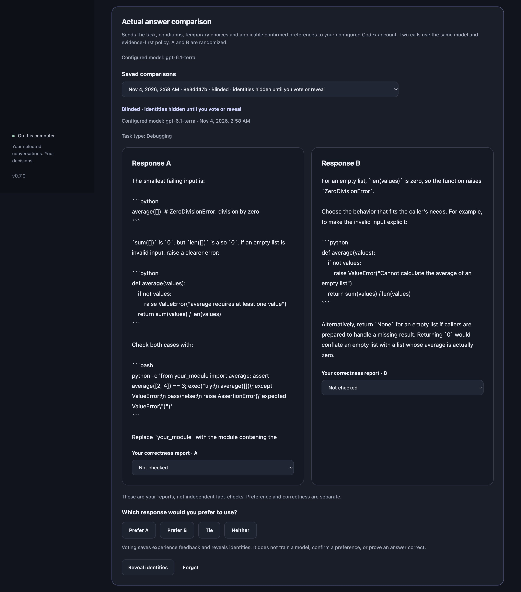

# User Behavior Personalization

[English](README.md) · [中文](README.zh-CN.md) · **v0.7.0**

“Show me the failing input before the fix” should change the next debugging answer. It should not dictate how your assistant writes a customer email.

This local workspace learns from the conversation excerpts you select, lets you confirm what it found, and applies those preferences to matching tasks. Compare two actual model responses to see the difference, then record what helped and what was wrong separately.



*Actual browser capture using synthetic feedback and a Python debugging task. Both answers come from the configured Codex model; their identities stay hidden until you vote or reveal them.*

[Download v0.7.0](https://github.com/KarmenLoop/user-behavior-personalization/releases/tag/v0.7.0) · [Complete walkthrough](docs/semantic-learning.en.md) · [Evaluation](docs/evaluation.md) · [Six-part roadmap](docs/roadmap.en.md)

## Start locally

Download, verify and extract the release. Python **3.11+** is required; the local runtime has no third-party Python dependencies.

```sh
python3 -B scripts/check_package.py
python3 -B scripts/workspace.py --root ../private-profile --subject demo --enable-conversations
```

Open the printed local URL. This starts the offline workspace: import authorized conversations, review literal preferences or recurring feedback, inspect task prompts, and manage your private profile. No model account is needed for those steps. [Try the offline tutorial](docs/tutorial.en.md).

For semantic interpretation and actual answer comparisons, install and sign in to a compatible Codex CLI, then restart with an explicit model:

```sh
python3 -B scripts/workspace.py --root ../private-profile --subject demo \
  --enable-conversations --enable-models --model YOUR_MODEL
```

The tested client is `codex-cli 0.165.0-alpha.1.2`; incompatible tool controls fail closed. On macOS, `--system-proxy` can opt into an existing fixed loopback proxy. It changes only the model child process environment.

1. Import a conversation you are allowed to use. Check only the excerpts you want analyzed, then select **Analyze selected excerpts**. Those excerpts and relevant confirmed preferences go to your configured Codex account.
2. Read each proposed preference and its exact quote. Correct an existing rule deliberately or keep a separate preference. Model proposals remain inactive until you review them.
3. Open **Shape the next task**. Set the task type, audience and stage that apply. Preview why a preference is included or excluded.
4. Select **Compare actual answers**. The same model answers the same task twice with the same evidence policy and temporary requirements; one arm receives applicable saved preferences. A/B labels and call order are randomized.
5. Choose A, B, tie or neither. Report correctness separately. Voting reveals the mapping and records an experience report; it changes no factual conclusion or active rule.

## What you can inspect

**Learning beyond literal phrases.** The optional semantic path can interpret indirect feedback. Every proposal retains selected-source quotes and its conditions. Importing or refreshing alone never sends data to a model. The offline cue learner remains available, with its earlier misses documented.

**Preferences with a place and time.** Scope, task type, audience, stage, expiry, omissions and temporary controls determine which rules apply. Missing conditions do not match; equally specific conflicting typed preferences are left out. Arbitrary free-text conflicts still need your review.

**Actual answers alongside prompt previews.** Both views use the same resolver. Private comparisons retain model/client metadata and exact preference versions. Per-arm metadata is hidden before reveal. A failed, paused or stale request saves no partial pair.

**Feedback with an honest boundary.** Preference votes, reported correctness and prepared-plan ratings are separate. Revealing first marks later votes as unblinded. A corrected preference inherits no old score. No model weights are trained, and a good rating is not treated as evidence that a claim is true.

**Evidence before agreement.** User explanations and diagnoses remain hypotheses. Both arms carry the same requirements to check evidence, consider counterexamples, distinguish unknowns and revise conclusions for evidence or stronger reasoning. These safeguards do not establish that model sycophancy has been eliminated. [Read the policy and limits](docs/independent-judgment.en.md).

## Keep control of the profile

Profiles and up to 20 private response pairs stay in a dedicated SQLite root outside the package. Pause hides ordinary evidence and answers and discards stale in-flight results. Forgetting source evidence removes dependent rules, plans, answers and feedback; reset clears profile content and ends paused. Provider history, terminal captures and external backups have their own retention boundaries. [Storage and deletion](docs/privacy-and-memory-control.md).

A selected-file watcher, open-text preferences, stated goals, writing observations and experimental historical follow-up retrieval remain available. The watcher follows one authorized file; it does not crawl accounts. [Feed format and recovery](docs/automatic-learning.en.md) · [Conversation tools](docs/conversation-guide.en.md).

Codex and Cursor can use the existing MCP configuration helpers or invocation wrapper. `build_context.py` generates scoped context for your own client, including DeepSeek-style APIs. Native host coverage and ongoing multi-turn evaluations remain on the [roadmap](docs/roadmap.en.md); configuration is not proof of actual model use.

## Check the work

[Current evaluation](docs/evaluation.md) separates actual provider completion, semantic proposal review, local runtime checks and user benefit. The earlier unseen lexical result of **1/8** and earlier provider failures remain recorded. The v0.7.0 semantic cases are author-created synthetic acceptance data, not a new independent generalization score.

- [Semantic workflow](docs/semantic-learning.en.md) / [中文](docs/semantic-learning.zh-CN.md): setup, selected evidence, review, conditions, actual answers and deletion.
- [Offline tutorial](docs/tutorial.en.md), [host integration](docs/host-integration.md) and [30-tool reference](docs/tools.en.md).
- [Model checks](docs/model-checks.en.md), [research](docs/research.en.md) and [20 practical questions](docs/faq.en.md).

[Apache-2.0](LICENSE) · [KarmenLoop](https://karmenloop.com) · [Support](SUPPORT.md) · [Security](SECURITY.md)

Historical overviews: [v0.2.0](docs/overview-v0.2.0.en.md), [v0.3.0](docs/overview-v0.3.0.en.md), [v0.4.0](docs/overview-v0.4.0.en.md), [v0.6.0](docs/overview-v0.6.0.en.md).
