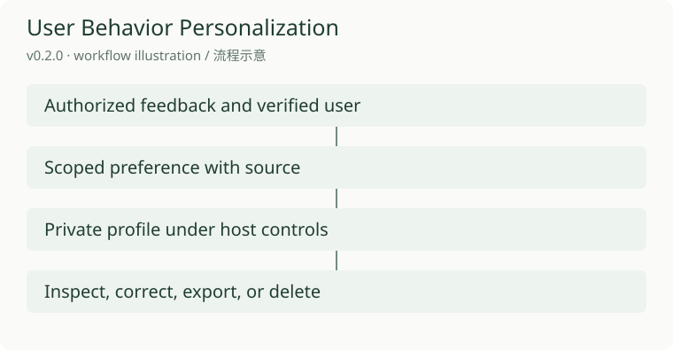
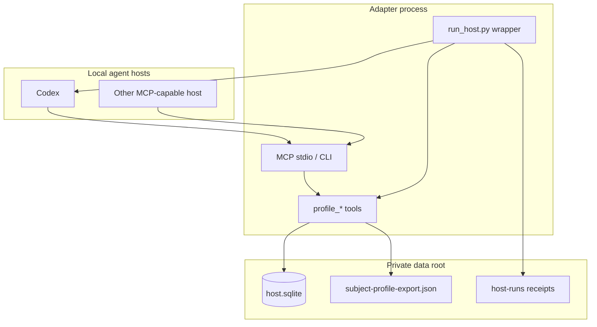
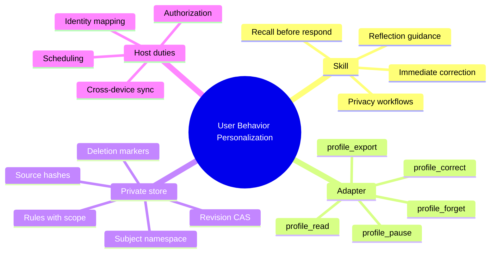
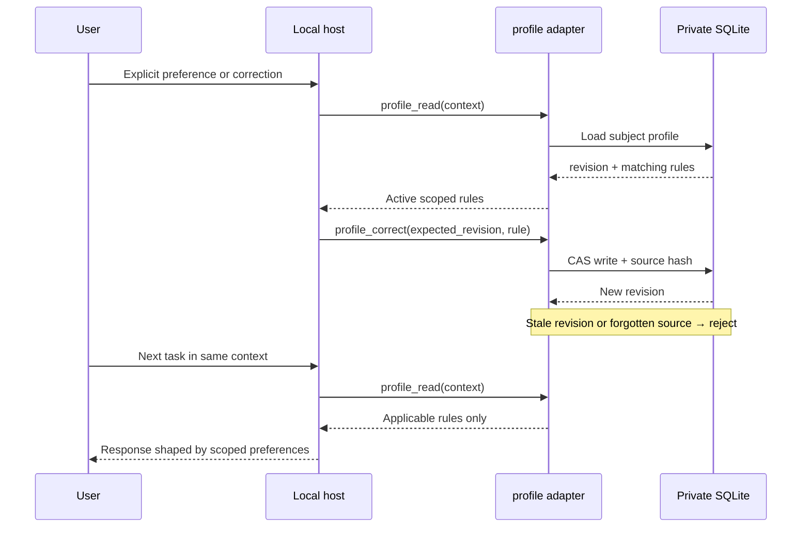
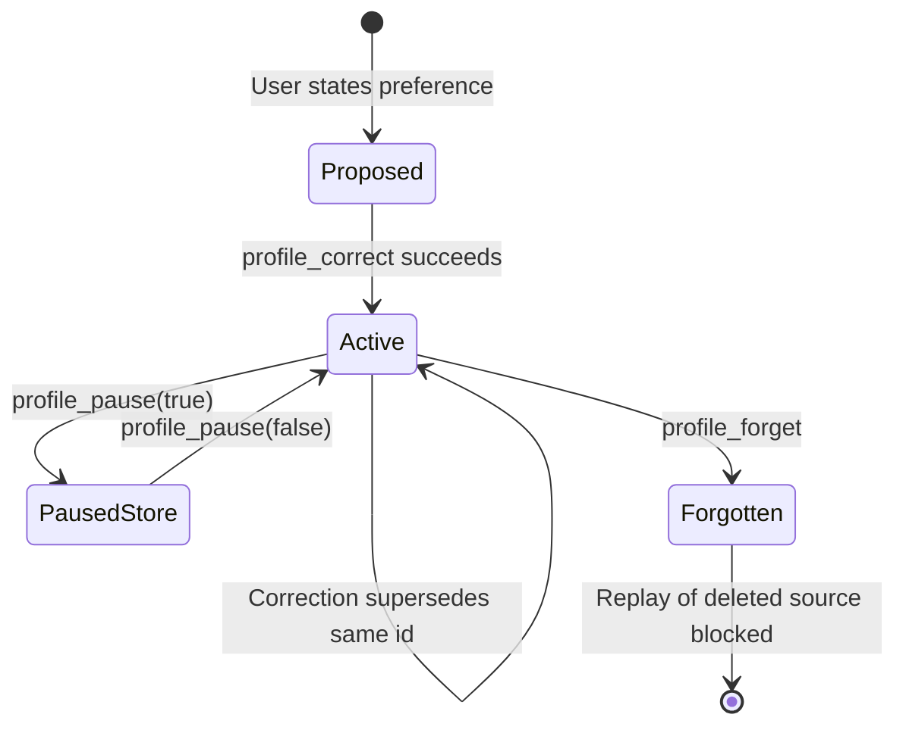

# User Behavior Personalization

[English](README.md) · [中文](README.zh-CN.md) · **v0.2.0**

[](https://github.com/KarmenLoop/user-behavior-personalization/actions/workflows/checks.yml)
[](https://github.com/KarmenLoop/user-behavior-personalization/releases/latest)
[](https://www.python.org/downloads/)
[](LICENSE)
[](docs/tutorial.en.md)

**Preferences that stay local, stay scoped, and stay correctable—without quietly inventing who you are.**

User Behavior Personalization is an **agent skill** plus a small **Python 3.11+ MCP/CLI adapter**. It stores subject-bound preference rules in a **private SQLite** profile, attaches every write to a **source**, and lets a local host **read only the rules that match the current task**. When a preference changes, you correct it transactionally. When you ask to forget it, the adapter purges controlled copies and refuses to recreate the same rule from a deleted source.

Built and maintained by [KarmenLoop](https://github.com/KarmenLoop) / [KARMENLOOP](https://karmenloop.com). Current release: **[v0.2.0](https://github.com/KarmenLoop/user-behavior-personalization/releases/tag/v0.2.0)**. License: **Apache-2.0**.

<!-- Optional hero assets — add when you have real screenshots:


-->



[Download v0.2.0](https://github.com/KarmenLoop/user-behavior-personalization/releases/tag/v0.2.0) · [Tutorial](docs/tutorial.en.md) · [中文教程](docs/tutorial.zh-CN.md) · [Privacy controls](docs/privacy-and-memory-control.md)

---

## Why this exists

Most “agent memory” is either a pasted chat dump or a black-box vector store. Both fail the same way: you cannot tell **what** was learned, **from which message**, **for which task type**, or **whether the user can undo it**.

This package treats personalization as a **systems problem**:

- a preference is a **scoped rule**, not a personality label;
- a write needs a **source** and a **revision**, not vibes;
- recall loads a **compact active set**, not every conversation;
- pause, export, and forget are first-class operations;
- the controller skill stays stable while the private per-user guide evolves.

It does **not** train model weights, invent identity mappings, schedule daily reflection by itself, or sync profiles across devices. Those remain host responsibilities. What it *does* ship is a trustworthy local place to keep collaboration preferences that you can inspect and reverse.

---

## Snapshot

| | |
|---|---|
| **What you install** | Skill tree (`SKILL.md` + `references/` + templates) and `scripts/host.py` adapter |
| **Runtime** | Python **3.11+**, stdlib-oriented adapter path |
| **Persistence** | Private `--root` → `host.sqlite` (mode-restricted directory + DB) |
| **Transport** | MCP stdio *and* plain CLI (`call` / `install` / `mcp`) |
| **Subject binding** | `--subject` fixed in server/CLI config — **not** chosen by tool arguments |
| **Tools** | `profile_read`, `profile_correct`, `profile_pause`, `profile_forget`, `profile_export` |
| **Concurrency** | `expected_revision` compare-and-swap; stale writes rejected |
| **Privacy ops** | Pause ordinary recall/writes; export JSON; forget rule + controlled history |
| **Pre-invoke wrapper** | `scripts/run_host.py` loads scoped rules before starting a real CLI host |
| **License** | Apache-2.0 |

---

## Is / Is not

| Is | Is not |
|---|---|
| Local, subject-bound preference memory with sources | Cloud memory SaaS or multi-device sync |
| Skill + executable MCP/CLI adapter | Autonomous agent runtime |
| Scoped recall for the current task context | Dump-all chat history into the prompt |
| Transactional correction with revision checks | Silent overwrites from stale clients |
| Pause / export / forget with replay suppression | Guaranteed physical SSD wipe |
| Wrapper that loads preferences before a new CLI run | Automatic hooks inside every already-open desktop chat |
| Evidence categories and reflection *guidance* in Markdown | Built-in scheduler, identity provider, or history crawler |

---

## Architecture

Three layers stay deliberately separate:

1. **Method layer (skill)** — `SKILL.md` routes when to recall, correct, reflect, or honor memory-control requests. `references/` define profile format and reflection mechanics. This is discipline and policy, not a daemon.
2. **Adapter layer (executable)** — `scripts/host.py` + `scripts/host_support.py` expose five MCP tools, validate inputs, and commit transactional updates to private SQLite. The same process serves CLI inspection.
3. **Private state** — one data root per isolation boundary. Profiles are keyed by subject. Workspace files and chat providers stay outside the store; the adapter keeps rules, source hashes, history, and an append-only event stream.



### Mental model



### Learning and application loop



### Rule lifecycle



---

## Compared with “just paste the chat”

| Concern | Paste / summary | This package |
|---|---|---|
| Provenance | Unclear | Every rule carries `source_id` + summary |
| Scope | Usually global | `scope` per rule (`*` or task context) |
| Conflict | Last paste wins | Same `id` supersedes; revision CAS rejects stale writers |
| Cross-user bleed | Easy if shared threads | Subject bound outside tool args |
| Undo | Manual editing | `profile_forget` + deleted-source suppression |
| Pre-task load | Hope the model remembers | Wrapper can inject current rules before CLI start |
| Training claim | Often implied | Explicitly does **not** retrain weights |

---

## Feature depth

### Five tools

| Tool | Role |
|---|---|
| `profile_read` | Return active rules for the configured subject and a task `context`. Paused profiles return no ordinary rules. |
| `profile_correct` | Atomically commit an explicit preference or correction. Requires `expected_revision` and a sourced rule. |
| `profile_pause` | Pause or resume ordinary recall and corrections. Export remains available while paused. |
| `profile_forget` | Remove one rule and controlled historical content; keep source hashes only to block replay. |
| `profile_export` | Write a private JSON export for the bound subject (including while paused). |

### Rule shape (adapter)

A committed rule includes at least:

- `id` — stable rule identity (ASCII identifier)
- `statement` — what to do when the rule applies
- `scope` — `*` or a context string matched case-insensitively
- `source_id` / `source_summary` — provenance
- `kind` — `explicit` or `correction`
- optional `expires_at` — timezone-qualified ISO timestamp

Hard limits in the current adapter: at most **30** active rules; source hashes prevent silent re-ingest of unchanged or forgotten sources.

### Subject isolation

The server/CLI process is started with `--subject`. Tool callers cannot switch subjects by argument. Separate subjects keep separate records under the same data root. Mapping a real person to that opaque ID is an **account-owner** responsibility; this release does not auto-discover chat-provider identities.

### Pre-invoke wrapper

`scripts/run_host.py` reads the current scoped profile, prefixes the task prompt with the active rules (without granting execution authority), starts a supported local CLI host, and writes a receipt under `host-runs/` (revision used, rule IDs, exit code, stdout/stderr paths). It creates no cron job and installs no global lifecycle hook. If the profile cannot be read, the wrapper fails instead of pretending preferences were applied.

### Skill-side workflows (guidance)

The Markdown skill still describes:

- evidence categories (confirmed / tentative / observation-only);
- selective recall of a few relevant rules;
- immediate application of explicit corrections;
- reflection and profile-format references for hosts that supply identity, sources, and triggers.

Those workflows are **instructions and contracts**. Automatic ingestion and daily timers are **not** shipped as services in v0.2.0—see [Host Integration](docs/host-integration.md).

---

## Quickstart

Requirements: Python **3.11+**, a private data directory outside Git, and a local host that can load MCP stdio tools (Codex install helper is included).

### 1. Install and bind a subject

```sh
python /path/to/scripts/host.py \
  --root /private/profiles \
  --workspace /path/to/project \
  --subject owner \
  --install-host codex \
  install
```

Reload the host, approve this server, and confirm the five `profile_*` tools appear. The subject is fixed in the server entry—not in tool arguments.

### 2. Read → correct → re-read

```sh
# model-free path
python /path/to/scripts/host.py \
  --root /private/profiles \
  --workspace /path/to/project \
  --subject owner \
  call profile_read --input request.json
```

A correction needs the current revision from `profile_read`, a new `source_id`, and a well-scoped `statement`. Stale revisions are rejected. Unrelated contexts return no rule. Another bound subject sees its own profile.

### 3. Load before a new CLI task

```sh
python /path/to/scripts/run_host.py \
  --root /private/profiles \
  --subject owner \
  --context writing \
  --host codex \
  --workspace /path/to/project \
  --prompt /private/task.txt
```

Each host still needs its own login and model access. Inspect the receipt under `host-runs/` after the run.

### 4. Pause, export, forget

Use the current revision with `profile_pause`, `profile_export`, and `profile_forget`. Forgotten sources cannot recreate deleted rules by replay. External backups remain separate copies—see [Privacy and Memory Control](docs/privacy-and-memory-control.md).

Full walkthrough: [docs/tutorial.en.md](docs/tutorial.en.md).

---

## Documentation map

| Doc | Contents |
|---|---|
| [Tutorial (EN)](docs/tutorial.en.md) / [中文](docs/tutorial.zh-CN.md) | Install, correct, wrap, privacy ops |
| [Quick start](docs/quickstart.md) | Skill-oriented setup and first correction check |
| [Architecture](docs/architecture.md) | Evolution unit, evidence, isolation, failure stages |
| [Host integration](docs/host-integration.md) | What v0.2.0 implements vs host-owned work |
| [Privacy and memory control](docs/privacy-and-memory-control.md) | Inspect, pause, forget, export, shared-chat limits |
| [Evaluation](docs/evaluation.md) | Observable checks without invented scores |
| [SKILL.md](SKILL.md) | Stable controller for agents |
| [Profile format](references/profile-format.md) | Private `USER_SKILL.md` shape |
| [Reflection workflow](references/reflection-workflow.md) | Catch-up / scheduled reflection contract |
| [SECURITY.md](SECURITY.md) / [SUPPORT.md](SUPPORT.md) / [CONTRIBUTING.md](CONTRIBUTING.md) | Ops and contribution |

---

## Validation (honest)

Release notes for **v0.2.0** report: repository tests, real MCP calls, an extracted-package correction/pause/delete flow, a live Codex run that loaded and followed a saved preference, and CI on macOS, Linux, and Windows.

Still **out of scope / not claimed**:

- automatic chat identity mapping;
- daily reflection scheduling as a built-in service;
- conversation-history ingestion;
- guaranteed per-turn hooks in already-running desktop chats;
- multi-device synchronization;
- physical secure erase of every storage medium.

Package and CI checks validate structure and adapter behavior. They do not certify every host’s model conversation or production deployment.

---

## FAQ

### What problem does this solve for AI agents?

It gives a local host a **durable, inspectable preference layer**: save an explicit preference once, apply it on later tasks in the right scope, and correct or forget it without relying on chat summarization.

### Is this long-term memory / RAG for agents?

It is **structured preference memory**, not a general retrieval index over all chats. Rules are small, scoped, sourced, and revisioned. You can point reflection workflows at authorized messages, but the adapter itself does not crawl history.

### How is this different from ChatGPT custom instructions or a system prompt?

Custom instructions are usually global text. Here each rule has **scope**, **source**, **revision**, and **privacy operations**. Multiple contexts can coexist; a forgotten rule cannot be silently rebuilt from the same deleted source.

### Does it train or fine-tune my model?

No. Changing a profile updates local instructions/state. It does not retrain weights or expand execution authority.

### Which hosts work?

Any host that can launch the MCP stdio server. An install helper writes a Codex workspace MCP entry. Other MCP-capable local hosts can run the same `host.py … mcp` process. Prefer `run_host.py` when you need load-before-invocation for a new CLI task.

### How do I stop the agent from remembering me?

Call `profile_pause` (or follow the privacy doc). Ordinary recall returns no preferences and corrections are blocked until resume. Export and authorized deletion remain available so you keep control of stored data.

### What happens when I say “forget that”?

`profile_forget` removes the active rule and controlled historical content, deletes the adapter-managed export for that subject, and retains only content-free source hashes to suppress replay. Backups and provider logs outside the data root are separate—report them honestly.

### Can two people share one profile store?

They can share a machine root only if each has a distinct `--subject` binding and filesystem access control. Never let a conversation pick another subject. Group chats must not disclose private source messages just because a presentation preference was applied.

### Why was my correction rejected?

Common causes: stale `expected_revision`, paused memory, reused/forgotten `source_id`, invalid expiry without timezone, or hitting the 30-rule limit. Read first, then write.

### Is my data uploaded?

The adapter writes under your private `--root`. There is no hosted account required to store profiles. Calling a remote model through a CLI still follows that host’s own network and retention behavior.

### Where should I look if CI or docs disagree?

Trust `VERSION` / release tag **v0.2.0**, [docs/host-integration.md](docs/host-integration.md), and the tutorial for implemented adapter behavior. Markdown reflection/scheduler text describes host contracts; it is not proof those services are running.

---

## License and contact

Apache License 2.0 — see [LICENSE](LICENSE) and [NOTICE](NOTICE).

Maintainer: [KarmenLoop](https://github.com/KarmenLoop) · Site: [karmenloop.com](https://karmenloop.com)

Issues and support: follow [SUPPORT.md](SUPPORT.md). Prefer synthetic fixtures when reporting preference-related bugs.
