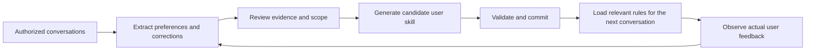

# User Behavior Personalization

This skill helps an agent remember how you like to work. It keeps preferences in a small guide you can inspect and correct, with a source for each change.

For example, a request for a short answer on one task should not make every future answer short. An explicit correction should replace an old preference. The skill describes how to handle both.

Built by [KarmenLoop](https://github.com/KarmenLoop).

[Download](https://github.com/KarmenLoop/user-behavior-personalization/releases) · [Quick Start](docs/quickstart.md) · [Documentation](#documentation) · [Contributing](CONTRIBUTING.md) · [License](LICENSE) · [Contact](#contact)

**License:** Apache-2.0. Personal, research, and commercial use are permitted under the terms in [LICENSE](LICENSE).

**Package:** Markdown skill, templates, integration guidance, and evaluation scenarios. No model runtime, background service, or hosted memory service is bundled.

## Overview

The agent keeps a per-user `USER_SKILL.md` and reads the relevant preferences before responding. Explicit requests are kept separate from tentative observations, and task-specific instructions stay scoped to the task.

The guide can change as you give feedback. Those changes update saved preferences, not model weights, system instructions, tool permissions, or account access. The host needs to provide storage and the hooks that load and update the guide.

## Capabilities

| Capability | Behavior | Requires from the host |
| --- | --- | --- |
| Communication preferences | Adapts language, detail, tone, structure, terminology, and forms of address | Skill loading and authorized conversation access |
| Working habits | Learns planning, decision, reporting, and delivery preferences | An agent that can apply the guidance |
| Daily reflection | Reviews newly available conversations and proposes specific improvements | A scheduler, session-end event, or next-session catch-up |
| Evolving user skill | Creates and revises a per-user `USER_SKILL.md` | Authorized persistent storage |
| Immediate correction | Applies explicit corrections during the current conversation | Persistence for later-session effects |
| Context-efficient recall | Selects a small set of relevant active rules | A profile-loading step before the response |
| Evidence tracking | Distinguishes confirmed preferences, tentative patterns, and temporary instructions | Stable source message identifiers |
| Memory control | Defines inspect, correct, export, pause, and forget workflows | Host operations that implement those actions |
| Cross-channel continuity | Reuses one profile for the same verified user | Verified identity mapping and an explicit sharing policy |
| Cross-device continuity | Reuses the current committed profile on another device | Host-provided synchronization and conflict handling |

Installing the skill does not create a timer, connect messaging applications, synchronize devices, or guarantee every response will load it. The integration points are documented and must be wired by the host.

## How It Works



Two layers keep the process maintainable:

1. **Stable controller: `SKILL.md`.** Defines what to learn, how to evaluate evidence, when to reflect, and how to update memory.
2. **Evolving profile: `USER_SKILL.md`.** Holds one user's current preferences and actionable collaboration rules. It remains private user data, separate from the public skill repository.

Daily reflection updates the same user guide when evidence justifies a change. It does not produce an ever-growing collection of globally discoverable personal skills.

### Example: Learning a Conditional Preference

> User: "Keep today's status update short."

The agent records a temporary request for that update.

> User, later: "For future answers, start with the conclusion. Keep simple questions short, but give me the full implementation details for complex work."

The user guide gains a confirmed rule:

> Start with the conclusion. Keep simple answers concise. For complex implementation work, include the necessary reasoning, steps, and validation.

The agent applies the rule to the next relevant response. Further feedback can narrow, replace, or remove it.

## Quick Start

### 1. Obtain the Package

Download a package from [Releases](https://github.com/KarmenLoop/user-behavior-personalization/releases), use GitHub's **Code → Download ZIP** action, or clone the repository:

```bash
git clone https://github.com/KarmenLoop/user-behavior-personalization.git
cd user-behavior-personalization
```

The checkout must contain `SKILL.md`, `references/`, and `assets/` together.

### Install a portable copy

Copy the validated package to a new directory selected for your agent host:

```sh
python3 scripts/install_skill.py --destination ../installed-skills/user-behavior-personalization
```

The installer preserves the blank templates and refuses an existing destination. It does not create a private user profile, schedule reflection, or change host permissions. Run `python3 -B -m unittest discover -s tests -v` to check the installation behavior locally.

### 2. Load the Skill

Use your agent host's skill installation or loading mechanism. When it expects a directory named after the skill, use `user-behavior-personalization` as that directory name.

For a host that reads Markdown instructions explicitly, start with:

```text
Read SKILL.md from the user-behavior-personalization package.
Apply it to the current user's authorized conversations.
Use only the storage and scheduling operations this host actually provides.
```

No package installation command is required to read the skill. Durable memory requires writable storage; unattended reflection requires a host event or scheduler.

### 3. Configure the Host

Map the following fields to your host's own configuration. These names describe the integration contract; they are not environment variables consumed by a bundled application.

| Field | Meaning |
| --- | --- |
| `PROFILE_ROOT` | Approved private storage location, outside the public checkout |
| `USER_ID` | Stable identity verified by the host |
| `USER_TIMEZONE` | Timezone used to group daily reflections |
| `MEMORY_ENABLED` | Whether personalization memory may be read and updated |
| `CONVERSATION_SOURCE` | Authorized messages available for analysis |
| `REFLECTION_TRIGGER` | Session end, scheduled run, or next-session catch-up |

Copy [the templates](assets/templates/) into that user's private directory and replace the documented template fields. See [Quick Start](docs/quickstart.md) for the exact setup sequence.

### 4. Connect the Lifecycle

```text
Before a personalized response:
  Load the current user's guide and choose relevant active rules.

When the user explicitly corrects a preference:
  Apply the correction now; persist it when authorized and available.

At the configured reflection event:
  Review new messages, validate changes, commit the guide, then checkpoint progress.
```

If a host has no background scheduler, run catch-up at the next conversation. Do not claim that an unattended daily job is active.

## Private Memory Layout

```text
<PROFILE_ROOT>/<USER_ID>/
  USER_SKILL.md
  state.json
  reflections/
    YYYY-MM-DD.md
  versions/
    USER_SKILL.vNNNN.md
```

Only the public controller, blank templates, and synthetic examples belong in Git. Real profiles, chat exports, reflection logs, credentials, and synchronization configuration stay in approved private storage.

## Compatibility and Platforms

The core instructions are plain Markdown and do not require a particular model provider, operating system, vector database, or agent framework. A host must be able to load the instructions and expose the capabilities needed for the workflow it enables.

The repository includes [optional skill UI metadata](agents/openai.yaml). This is packaging metadata, not evidence of a tested integration with any product.

| Host capability | Result |
| --- | --- |
| Instruction loading only | Current-conversation adaptation |
| Instruction loading and persistent files | Preferences can survive sessions |
| Persistent files and lifecycle hooks | Repeatable reflection and recall workflow |
| Verified identity and synchronized storage | Cross-channel or cross-device continuity |

No end-to-end host certification is claimed in this initial package. Review [the evaluation guide](docs/evaluation.md) before enabling a production integration.

## Documentation

| Guide | Contents |
| --- | --- |
| [Quick Start](docs/quickstart.md) | Setup, invocation, first correction, and first reflection |
| [Architecture](docs/architecture.md) | Stable instructions, evolving profiles, evidence, and context use |
| [Host Integration](docs/host-integration.md) | Required operations, lifecycle events, identity, commits, and synchronization |
| [Privacy and Memory Control](docs/privacy-and-memory-control.md) | Authorization, sensitive data, sharing, export, deletion, and retention |
| [Evaluation](docs/evaluation.md) | Behavioral scenarios, observable evidence, and release checks |
| [Profile Format](references/profile-format.md) | Profile fields, state format, evidence, and precedence |
| [Reflection Workflow](references/reflection-workflow.md) | Daily review, publication, recovery, and rollback |
| [Examples](examples/conversations.md) | Synthetic conversations and expected outcomes |

## Contributing

Bug reports, documentation improvements, host adapters, and focused pull requests are welcome. Read [CONTRIBUTING.md](CONTRIBUTING.md) before submitting a change.

Useful contributions include clearer evidence handling, better correction and forgetting behavior, realistic evaluation cases, and host integrations with reproducible instructions. Use synthetic data in every public report.

There is no required contributor license agreement in this package. Contributions are submitted under the repository's Apache-2.0 license.

## Security and Support

For reproducible non-sensitive bugs and feature requests, use this repository's Issues tab after publication. Read [SUPPORT.md](SUPPORT.md) for the information to include.

For a vulnerability or private-data exposure, follow [SECURITY.md](SECURITY.md). Do not publish real profiles, credentials, or conversation histories in a public issue.

## License

Copyright © 2026 KarmenLoop and User Behavior Personalization contributors.

This project is licensed under the [Apache License, Version 2.0](LICENSE). The license permits use, modification, redistribution, and commercial use subject to its terms and includes an express contributor patent grant. Preserve the applicable license and notices when redistributing. Third-party materials and attribution are described in [NOTICE](NOTICE).

## Acknowledgments

The package uses the conventional `SKILL.md` structure and Markdown-based, file-backed instructions. It is an independent skill package. It is not an official integration, endorsement, or release of any agent host.

## Contact

[GitHub Issues](https://github.com/KarmenLoop/user-behavior-personalization/issues) · [KarmenLoop](https://github.com/KarmenLoop) · [Security Policy](SECURITY.md)

Private vulnerability reporting depends on the repository owner's configured GitHub reporting channel; see [SECURITY.md](SECURITY.md).
