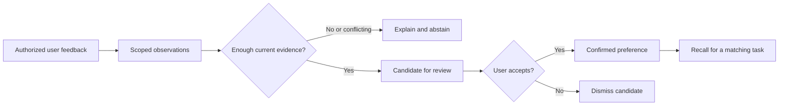

# User Behavior Personalization

[English](README.md) · [中文](README.zh-CN.md) · **v0.3.0**

[](https://github.com/KarmenLoop/user-behavior-personalization/actions/workflows/checks.yml)
[](https://github.com/KarmenLoop/user-behavior-personalization/releases/latest)
[](LICENSE)

An assistant should remember that you want a short status update and a thorough code review—and know when to ask again.

This package gives local agent hosts a shared, inspectable preference store. Save what the user explicitly requests, collect authorized feedback, review emerging patterns, and load the right preferences for the next task. Each change has a source. Every inferred preference remains a proposal until the user confirms it.

Built by [KarmenLoop](https://github.com/KarmenLoop). Python **3.11+**, standard library, SQLite, CLI and MCP stdio. No model weights or hosted account are needed for the local workflow.


[Download v0.3.0](https://github.com/KarmenLoop/user-behavior-personalization/releases/tag/v0.3.0) · [Start here](docs/tutorial.en.md) · [20 practical questions](docs/faq.en.md) · [Research and design choices](docs/research.en.md)

## What changes in 0.3.0

| Capability | What you can actually do |
|---|---|
| Learn from feedback | Record structured observations across independent sessions; repeated imports do not add support. |
| Understand a suggestion | Inspect supporting and opposing evidence, age, scope, and the reason a candidate is ready—or why the system abstains. |
| Keep control of changes | Accept or reject a candidate. Only accepted candidates become active preferences. |
| Adapt by task | Use exact context labels, such as `status-update` and `code-review`, with explicit global defaults when needed. |
| Adjust teaching | Offer worked examples, practice, or explain-back based on the user's feedback and confirmed choice. |
| Suggest what comes next | Review a context-specific next-step preference, such as testing after implementation. The suggestion does not execute anything. |
| Correct or remove memory | Correct, pause, export, forget observations and derived rules, or reset the profile. |
| Use more than one host | Connect Codex and Cursor to the same local store; generate a scoped request payload for a DeepSeek-style chat API. |

The new learning path is opt-in. It uses six bounded dimensions, a 200-observation limit, a 90-day evidence window, and recency weighting. These are transparent product heuristics, not a validated measure of personality or a probability of knowing what someone thinks.

## A concrete example

**Before:** an assistant notices one short answer and assumes you always dislike detail.

**With this package:** “Keep this update short” stays in its task. Three separate, authorized feedback events can support a candidate for `status-update`. The candidate shows its evidence; the user decides whether to keep it. A detailed `code-review` preference can coexist with it.



## Install and try it

Download the release archive, verify its `SHA256SUMS.txt`, and extract it. From the extracted directory:

```sh
python3 --version
python3 -B scripts/check_package.py
python3 -B scripts/host.py --root ../private-profile --subject demo \
  call profile_read --input examples/requests/read-code-review.json
```

The last command reads a synthetic subject in a private directory outside the package. It needs no model, token, or conversation history. Follow the [tutorial](docs/tutorial.en.md) for a complete read → save → observe → review → recall → forget exercise.

To add the MCP server to an existing project:

```sh
python3 scripts/host.py --root ../private-profile --subject owner \
  --workspace /path/to/project --enable-observations --install-host codex install
```

Use `--install-host cursor` for Cursor. Reload the host, approve this server, and verify its tools. Configuration files alone do not prove a working model conversation. The host must bind the subject to the intended person and obtain permission before recording feedback.

## Ten tools, one local profile

| Tool | Purpose |
|---|---|
| `profile_read` | Load confirmed rules for an exact context or a global `*` scope. |
| `profile_correct` | Save an explicit preference or correction with its source and current revision. |
| `profile_observe` | Record an authorized, structured feedback event when observation is enabled. |
| `profile_insights` | Explain candidates and evidence gaps without applying them. |
| `profile_review` | Accept or reject a current candidate using a new review source. |
| `profile_pause` | Stop ordinary recall and learning until resumed. |
| `profile_forget` | Remove a rule, its controlled history, and linked learning evidence. |
| `profile_forget_observations` | Remove specified observations and dependent learned rules. |
| `profile_export` | Inspect or export the current private profile, including while paused. |
| `profile_reset` | Clear profile content, keep replay-suppression hashes, and pause the profile. |

Writes use revision checks, so a stale client cannot quietly replace a newer correction. Rules do not grant execution permission. Current user instructions and the host's instruction hierarchy still apply.

## Host support and honest limits

| Path | Included | Separate acceptance |
|---|---|---|
| Local CLI / MCP | Storage, validation, learning, review, and privacy operations | Your identity mapping and authorization |
| Codex / Cursor | Workspace MCP configuration and a pre-invocation wrapper | Each host's login, version, permissions, and actual model response |
| DeepSeek-style chat API | `build_context.py` produces a request payload with scoped preferences | Your HTTP client, credentials, tool loop, provider policy, and live response |

There is no background history crawler, always-on recorder, cross-device sync service, or model fine-tuning. The adapter cannot read minds, diagnose psychological conditions, or certify that it understands every user. See [evaluation](docs/evaluation.md) for the difference between local tests, host calls, and measured user benefit.

## Guides

| Guide | English / 中文 |
|---|---|
| Download, install, configure, use, and troubleshoot | [Tutorial](docs/tutorial.en.md) / [教程](docs/tutorial.zh-CN.md) |
| Data flow, review, and deletion diagrams | [Architecture](docs/architecture.md) / [架构](docs/architecture.zh-CN.md) |
| Codex, Cursor, and model API integration | [Hosts](docs/host-integration.md) / [宿主接入](docs/host-integration.zh-CN.md) |
| Permission, storage, export, and deletion | [Privacy](docs/privacy-and-memory-control.md) / [隐私控制](docs/privacy-and-memory-control.zh-CN.md) |
| Learning methods and independent implementation | [Research](docs/research.en.md) / [研究依据](docs/research.zh-CN.md) |
| Twenty common questions | [FAQ](docs/faq.en.md) / [常见问题](docs/faq.zh-CN.md) |
| What to test before relying on a profile | [Evaluation](docs/evaluation.md) / [验收](docs/evaluation.zh-CN.md) |

The [v0.2.0 overview](docs/overview-v0.2.0.en.md) and older diagrams remain as historical records. For an upgrade, note that scope matching is now exact and case-insensitive: `art` no longer matches `cartography`. Existing explicit preferences remain readable. Old unbound wrapper logs require separate review and cleanup.

## License and support

[Apache-2.0](LICENSE). Original implementation and diagrams by KarmenLoop. References acknowledge design ideas; no external model weights or third-party memory engine are bundled. Product names do not imply affiliation.

[Contributing](CONTRIBUTING.md) · [Support](SUPPORT.md) · [Security](SECURITY.md) · [KarmenLoop](https://karmenloop.com)
