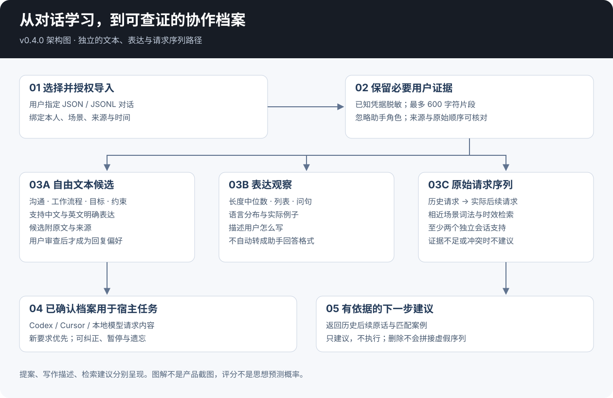
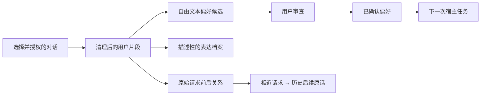

# 用户行为个性化

[English](README.md) · [中文](README.zh-CN.md) · **v0.4.0**

[](https://github.com/KarmenLoop/user-behavior-personalization/actions/workflows/checks.yml)
[](https://github.com/KarmenLoop/user-behavior-personalization/releases/latest)
[](LICENSE)

从用户真正说过的话里，学习解释偏好、项目术语、反复出现的工作流程，以及本人表达的目标。

本项目导入你选择的对话，从中提取中英文明确偏好，整理为可查看的协作档案。它还能描述表达习惯，并检索用户过去遇到相近请求时，接下来实际问了什么。每条结论可以查看来源、纠正，或随来源对话一起删除。

由 [KarmenLoop](https://github.com/KarmenLoop) 开发。使用 Python **3.11+** 标准库、私有 SQLite、CLI 与 MCP stdio。本地学习流程无需模型账号或 API 密钥。



[下载 v0.4.0](https://github.com/KarmenLoop/user-behavior-personalization/releases/tag/v0.4.0) · [完整教程](docs/tutorial.zh-CN.md) · [20 个实际问题](docs/faq.zh-CN.md) · [研究依据](docs/research.zh-CN.md)

## 从手动标签，到实际对话学习

| 原有结构化反馈 | 新增对话文本路径 |
|---|---|
| 宿主传入六类预设维度之一。 | 导入用户消息，提取自由文本的沟通偏好、工作流程、目标与约束。 |
| 下一步偏好只能选择固定动作。 | 从历史请求序列中检索真正发生过的后续请求。 |
| 档案主要是已保存规则。 | 同时查看已确认偏好、待审候选、表达特征、来源和例子。 |
| 每条观察都需宿主先归纳。 | 保守的中英文规则提取明确表达；可选模型桥接还能提出带原文证据的新解释。 |

原有结构化反馈仍然可用。对话路径需独立开启 `--enable-conversations`，两个开关互不替代。

## 一段话可以教会它什么

| 用户原话 | 可审查的结果 |
|---|---|
| “以后发布方案里，都要加上回滚检查清单。” | 当前项目场景下的自定义工作流程偏好。 |
| “请记住，我们的预演环境统一叫 rehearsal。” | 保留本人用词的项目术语。 |
| “我的目标是学会 SQL，能自己检查产品指标。” | 明确学习目标，与推测的能力水平分开。 |
| “以后写方案时，先给我能执行的步骤，再解释取舍。” | 自由文本偏好，不必压缩成少量固定标签。 |

“I prefer”“from now on”“my goal is”及支持的中文表达可产生候选。引用示例、代码、临时要求及识别到的敏感内容不进入自动偏好提取。这是保守的规则提取器，不是通用语义理解模型；具体见[评估结果与边界](docs/evaluation.zh-CN.md)。

## 同一份证据的三种用途

**协作档案。** `profile_portrait` 区分已确认偏好与待审提案，并显示消息长度中位数、列表、问句和语言混合等描述性特征，附来源片段。用户自己怎么写，不自动等于他希望助手怎么回答。

**实验性后续请求建议。** `profile_forecast` 在同一场景中比较当前请求与历史请求，返回后续原话、支持会话与匹配例子，或明确暂不建议。它使用自研的词法与时效评分，不再是六种固定动作，也不是“读懂思想的概率”。

**实际回复上下文。** 确认提案后，`profile_read`、CLI 包装入口或 `build_context.py` 可以在合适任务中加载。待审候选和表达统计不会悄悄变成助手必须遵守的指令。



## 运行一次真实本地导入

下载 ZIP，核对 `SHA256SUMS.txt` 后解压。在解压目录运行：

```sh
python3 -B scripts/check_package.py
python3 -B scripts/learn_conversation.py --root ../private-profile --subject demo \
  --enable-conversations --input examples/conversations/sample.zh-CN.json
```

命令通过实际适配器导入样例，并打印生成的档案。它只提出候选，不替你确认。[教程](docs/tutorial.zh-CN.md)包含自己的 JSON/JSONL 文件、审查、更正、后续建议、宿主配置与删除。

把项目接入 Codex 或 Cursor：

```sh
python3 scripts/host.py --root ../private-profile --subject owner \
  --workspace /path/to/project --enable-conversations --install-host codex install
```

Cursor 使用 `--install-host cursor`。在宿主中绑定正确本人，批准指定服务，再验证真实工具调用。DeepSeek 类 API 可通过自己的客户端使用本地生成的上下文，包本身不会自动调用提供方。

## 十八个本地工具

| 用途 | 工具 |
|---|---|
| 从选择的对话中学习 | `conversation_import`、`profile_proposal_review`、`profile_forget_conversation`、`profile_forget_messages` |
| 查看与预备下一步 | `profile_portrait`、`profile_forecast` |
| 可选宿主模型辅助 | `profile_model_context`、`profile_model_propose` |
| 保存与读取明确规则 | `profile_read`、`profile_correct` |
| 结构化反馈 | `profile_observe`、`profile_insights`、`profile_review`、`profile_forget_observations` |
| 档案控制 | `profile_pause`、`profile_forget`、`profile_export`、`profile_reset` |

写入需要当前版本。可用真实新来源纠正已确认提案，也可以删除来源对话及依赖它的内容。序列中间消息被删除后，不会把两侧消息拼出虚假的新关联。

## 当前实现范围

档案最多保留 80 个会话中的 400 条用户记录。每条存储清理后最多 600 字符的片段，以及特征和来源哈希。已知凭据和邮箱格式会脱敏，但不是完整个人信息检测器。助手、系统和工具消息不会作为用户证据保存。导入必须明确选择文件，没有后台历史爬虫或屏幕监控。

后续请求检索仍属实验功能，措辞接近时更适用。新一轮 18 条合成留出查询中，12 个应建议案例只正确提出 4 个，其余 8 个暂不建议；6 个负例全部暂不建议。英文正例覆盖 0/6，中文 4/6。这是小规模诊断，不是总体准确率。检索需要至少两个会话支持，可能漏掉改写或陌生主题。分数用于排列历史案例，不是校准过的概率。本地正确性测试、小规模冻结诊断与模型实际效果分别报告；宿主及提供方的验收状态和未成功尝试见[验收指南](docs/evaluation.zh-CN.md)。

## 文档导航

| 内容 | 中文 / English |
|---|---|
| 下载 → 导入 → 审查 → 使用 → 删除 | [教程](docs/tutorial.zh-CN.md) / [Tutorial](docs/tutorial.en.md) |
| 对话、档案与后续检索图解 | [架构](docs/architecture.zh-CN.md) / [Architecture](docs/architecture.md) |
| Codex、Cursor 与可选模型桥接 | [宿主接入](docs/host-integration.zh-CN.md) / [Hosts](docs/host-integration.md) |
| 文本片段、保留和删除 | [隐私](docs/privacy-and-memory-control.zh-CN.md) / [Privacy](docs/privacy-and-memory-control.md) |
| 研究与心理学启发的教学设计 | [研究依据](docs/research.zh-CN.md) / [Research](docs/research.en.md) |
| 二十个具体使用问题 | [常见问题](docs/faq.zh-CN.md) / [FAQ](docs/faq.en.md) |
| 诊断、失败与验收 | [验收](docs/evaluation.zh-CN.md) / [Evaluation](docs/evaluation.md) |
| 原有结构化反馈流程 | [指南](docs/structured-feedback.zh-CN.md) / [Guide](docs/structured-feedback.en.md) |

[v0.2.0](docs/overview-v0.2.0.zh-CN.md) 和 [v0.3.0](docs/overview-v0.3.0.zh-CN.md) 介绍保留为历史记录。已有档案仍可读取；本项目不训练模型，也没有跨设备同步服务。

## 许可与支持

使用 [Apache-2.0](LICENSE)。实现与图解由 KarmenLoop 原创。研究引用说明设计依据，论文中的成绩不等于本项目成绩。

[参与贡献](CONTRIBUTING.md) · [支持](SUPPORT.md) · [安全](SECURITY.md) · [KarmenLoop](https://karmenloop.com)
