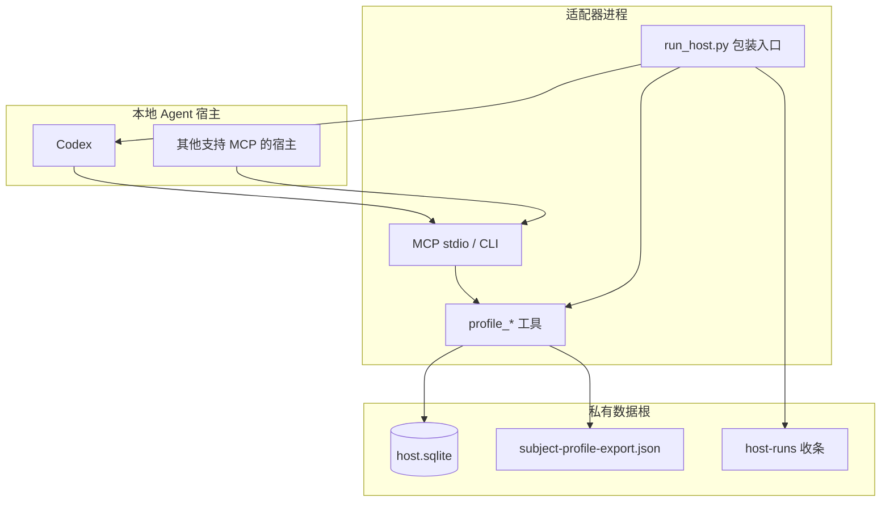
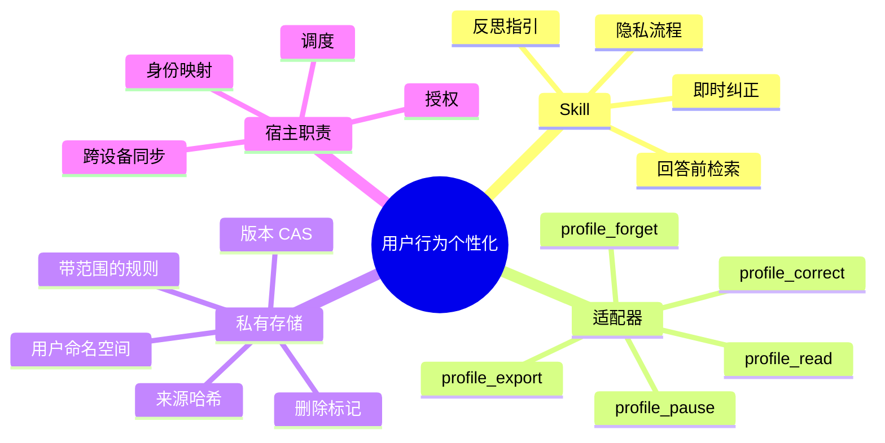
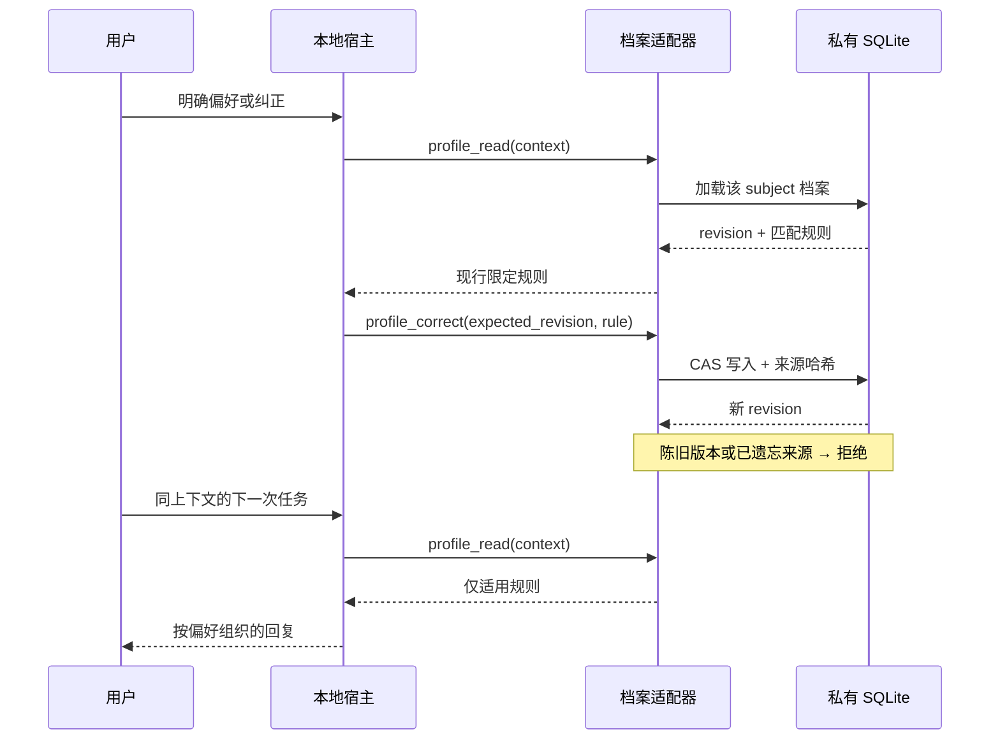
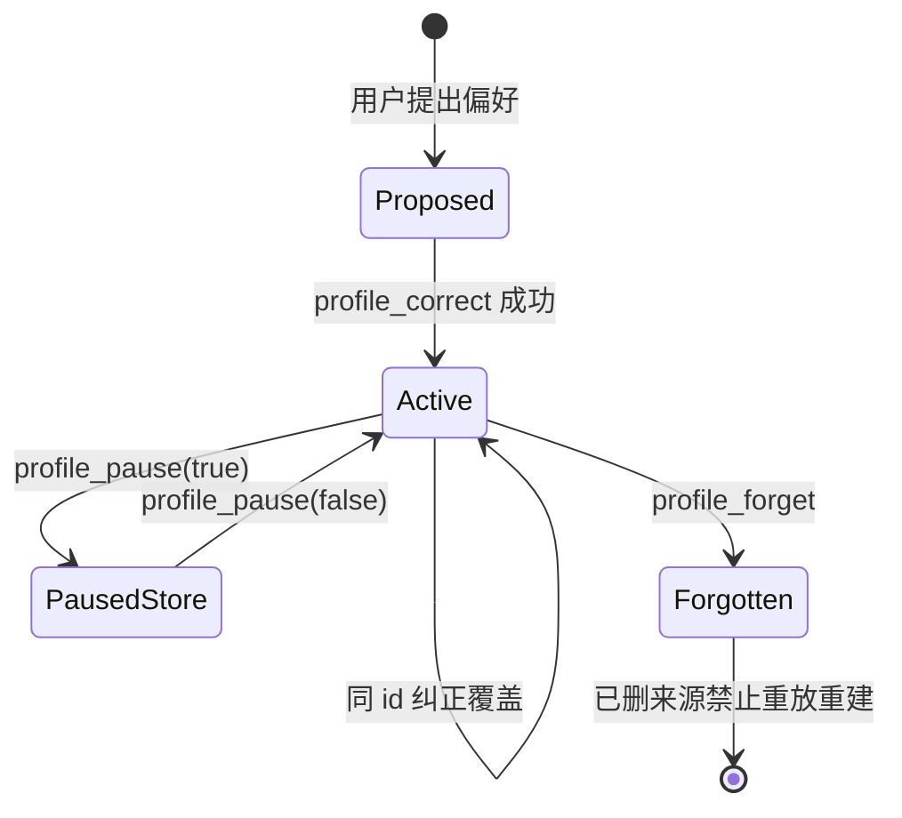

# User Behavior Personalization

[English](README.md) · [中文](README.zh-CN.md) · **v0.2.0**

[](https://github.com/KarmenLoop/user-behavior-personalization/actions/workflows/checks.yml)
[](https://github.com/KarmenLoop/user-behavior-personalization/releases/latest)
[](https://www.python.org/downloads/)
[](LICENSE)
[](docs/tutorial.zh-CN.md)

**偏好留在本机、按场景生效、随时可纠正——而不是悄悄替你「画像」。**

User Behavior Personalization 是一套 **Agent Skill**，外加精简的 **Python 3.11+ MCP/CLI 适配器**：把绑定用户的偏好规则写入**私有 SQLite**，每条写入都带来源；本地宿主只会读出**与当前任务匹配**的规则。偏好变了就事务式纠正；要遗忘时，适配器清理受控副本，并拒绝用已删除来源重放重建同一条规则。

由 [KarmenLoop](https://github.com/KarmenLoop) / [KARMENLOOP](https://karmenloop.com) 维护。当前版本：**[v0.2.0](https://github.com/KarmenLoop/user-behavior-personalization/releases/tag/v0.2.0)**。许可：**Apache-2.0**。

<!-- 有真实截图后再补：


-->


[下载 v0.2.0](https://github.com/KarmenLoop/user-behavior-personalization/releases/tag/v0.2.0) · [中文教程](docs/tutorial.zh-CN.md) · [English tutorial](docs/tutorial.en.md) · [隐私控制](docs/privacy-and-memory-control.md)

---

## 为什么做这个

常见的「Agent 记忆」要么是粘贴聊天摘要，要么是黑盒向量库。结果一样难看清：**学到了什么、来自哪条消息、适用哪类任务、用户能不能撤回**。

本仓库把个性化当成**系统问题**来做：

- 偏好是**带范围的规则**，不是性格标签；
- 写入需要**来源**和**版本**，不是「感觉记住了」；
- 检索只加载**紧凑的现行集合**，不是整段历史；
- 暂停、导出、遗忘是一等能力；
- 控制器 Skill 保持稳定，私有用户指南单独演进。

它**不会**训练模型权重、自动发现账号映射、自行挂每日反思定时器，也不会跨设备同步档案——那些仍归宿主。它交付的是：一份可检查、可纠正的本机协作偏好存档。

---

## 一览

| | |
|---|---|
| **安装内容** | Skill 树（`SKILL.md`、`references/`、模板）+ `scripts/host.py` 适配器 |
| **运行时** | Python **3.11+**，适配器以标准库路径为主 |
| **持久化** | 私有 `--root` → `host.sqlite`（目录与库文件权限收紧） |
| **传输** | MCP stdio，以及 CLI（`call` / `install` / `mcp`） |
| **用户绑定** | 启动时固定 `--subject`，**不能**由工具参数切换 |
| **工具** | `profile_read`、`profile_correct`、`profile_pause`、`profile_forget`、`profile_export` |
| **并发** | `expected_revision` 乐观锁；过期版本写入被拒 |
| **隐私操作** | 暂停普通读写；导出 JSON；遗忘规则与受控历史 |
| **调用前包装** | `scripts/run_host.py` 在启动真实 CLI 宿主前加载适用规则 |
| **许可** | Apache-2.0 |

---

## 是什么 / 不是什么

| 是 | 不是 |
|---|---|
| 本机、按用户隔离、带来源的偏好记忆 | 云端记忆 SaaS 或多设备同步服务 |
| Skill + 可执行 MCP/CLI 适配器 | 自主 Agent 运行时 |
| 按任务上下文做限定检索 | 把全部聊天塞进提示词 |
| 带版本校验的事务式纠正 | 陈旧客户端静默覆盖 |
| 暂停 / 导出 / 遗忘，并抑制来源重放 | 承诺物理抹除整块 SSD |
| 新 CLI 任务前可加载偏好的包装入口 | 已打开桌面会话里的逐轮自动钩子 |
| Markdown 里的证据分级与反思**指引** | 内置调度器、身份提供方或历史爬虫 |

---

## 架构

三层刻意分开：

1. **方法层（Skill）** — `SKILL.md` 决定何时检索、纠正、反思或执行记忆控制；`references/` 规定档案格式与反思流程。这是纪律与策略，不是守护进程。
2. **适配层（可执行）** — `scripts/host.py` 与 `scripts/host_support.py` 暴露五个 MCP 工具，校验输入，把事务写入私有 SQLite；同一进程也服务 CLI。
3. **私有状态** — 每个隔离边界一个数据根。档案按 subject 分键。工作区文件与聊天提供方留在库外；适配器只存规则、来源哈希、历史与追加事件流。



### 思维导图



### 学习与应用时序



### 规则生命周期



---

## 对照「直接粘贴聊天」

| 关注点 | 粘贴 / 摘要 | 本仓库 |
|---|---|---|
| 出处 | 往往说不清 | 每条规则带 `source_id` 与摘要 |
| 范围 | 常是全局 | 每条有 `scope`（`*` 或任务上下文） |
| 冲突 | 后贴覆盖 | 同 `id` 覆盖；CAS 拒绝陈旧写入 |
| 串用户 | 共享线程时易发生 | subject 在工具参数外绑定 |
| 撤回 | 靠手改 | `profile_forget` + 删除来源抑制 |
| 任务前加载 | 指望模型还记得 | 包装入口可在 CLI 启动前注入现行规则 |
| 训练暗示 | 常被夸大 | 明确**不**训练权重 |

---

## 能力细节

### 五个工具

| 工具 | 作用 |
|---|---|
| `profile_read` | 按已配置 subject 与任务 `context` 返回现行规则；暂停时不返回普通偏好 |
| `profile_correct` | 原子提交明确偏好或纠正；需要 `expected_revision` 与带来源的规则 |
| `profile_pause` | 暂停或恢复普通检索与纠正；暂停时仍可导出 |
| `profile_forget` | 清除一条规则及受控历史；仅保留防重放的来源哈希 |
| `profile_export` | 为绑定用户写出私有 JSON（暂停期间也可用） |

### 规则字段（适配器）

至少包含：

- `id` — 稳定规则标识（ASCII）
- `statement` — 适用时该怎么做
- `scope` — `*` 或大小写不敏感的上下文串
- `source_id` / `source_summary` — 出处
- `kind` — `explicit` 或 `correction`
- 可选 `expires_at` — 必须带时区的 ISO 时间

当前硬限制：最多 **30** 条现行规则；来源哈希阻止未变更或已遗忘来源的静默再写入。

### 用户隔离

进程以 `--subject` 启动，工具调用方不能改主体。同一数据根下不同 subject 各有档案。把真实身份映射到该不透明 ID，是**本机账号所有者**的责任；本版本不自动识别聊天平台账号。

### 调用前包装

`scripts/run_host.py` 先读现行限定档案，把适用规则前缀进任务提示（不授予额外执行权限），再启动受支持的本地 CLI 宿主，并在 `host-runs/` 写下收条（使用的版本、规则 ID、退出码、输出路径）。它不创建定时任务，也不装全局生命周期钩子。档案读失败时包装入口直接失败，不会假装已应用偏好。

### Skill 侧流程（指引）

Markdown Skill 仍说明：

- 证据分级（已确认 / 暂定 / 仅观察）；
- 只挑选少量相关规则；
- 明确纠正要立刻体现在当前回复；
- 宿主若提供身份、来源与触发器，可按反思与档案格式文档运作。

这些是**说明与契约**。自动采集与每日定时器在 v0.2.0 **未作为服务交付**——见 [宿主集成](docs/host-integration.md)。

---

## 60 秒上手

需要：Python **3.11+**、Git 之外的私有数据目录，以及能加载 MCP stdio 工具的本地宿主（含 Codex 安装助手）。

### 1. 安装并绑定用户

```sh
python /path/to/scripts/host.py \
  --root /private/profiles \
  --workspace /path/to/project \
  --subject owner \
  --install-host codex \
  install
```

重载宿主、批准该服务，确认五个 `profile_*` 工具可见。用户标识写在服务配置里，不在工具参数里。

### 2. 读取 → 纠正 → 再读

```sh
python /path/to/scripts/host.py \
  --root /private/profiles \
  --workspace /path/to/project \
  --subject owner \
  call profile_read --input request.json
```

纠正要用 `profile_read` 返回的当前版本、新的 `source_id`，以及范围清楚的 `statement`。陈旧版本会被拒；无关上下文不返回规则；其他绑定用户只见自己的档案。

### 3. 新 CLI 任务前加载

```sh
python /path/to/scripts/run_host.py \
  --root /private/profiles \
  --subject owner \
  --context writing \
  --host codex \
  --workspace /path/to/project \
  --prompt /private/task.txt
```

每个宿主仍需自己的登录与模型权限。跑完后看 `host-runs/` 收条。

### 4. 暂停、导出、遗忘

用当前版本调用 `profile_pause`、`profile_export`、`profile_forget`。已遗忘来源不能靠重放重建规则。外部备份是另一份副本——见 [隐私与记忆控制](docs/privacy-and-memory-control.md)。

完整步骤：[docs/tutorial.zh-CN.md](docs/tutorial.zh-CN.md)。

---

## 文档导航

| 文档 | 内容 |
|---|---|
| [中文教程](docs/tutorial.zh-CN.md) / [English](docs/tutorial.en.md) | 安装、纠正、包装入口、隐私操作 |
| [快速开始](docs/quickstart.md) | 偏 Skill 的安装与首次纠正核对 |
| [架构](docs/architecture.md) | 演进单元、证据、隔离、失败阶段 |
| [宿主集成](docs/host-integration.md) | v0.2.0 已实现 vs 宿主自担 |
| [隐私与记忆控制](docs/privacy-and-memory-control.md) | 查看、暂停、遗忘、导出、群聊边界 |
| [评估](docs/evaluation.md) | 可观察检查，不编造「理解分」 |
| [SKILL.md](SKILL.md) | 给 Agent 的稳定控制器 |
| [档案格式](references/profile-format.md) | 私有 `USER_SKILL.md` 形态 |
| [反思流程](references/reflection-workflow.md) | 补做 / 定时反思契约 |
| [SECURITY.md](SECURITY.md) / [SUPPORT.md](SUPPORT.md) / [CONTRIBUTING.md](CONTRIBUTING.md) | 安全、支持与贡献 |

---

## 验证说明（如实）

**v0.2.0** 发行说明记载：仓库测试、真实 MCP 调用、解压包上的纠正/暂停/删除流程、一次真实 Codex 回合在启动前加载并遵循已存偏好，以及 macOS / Linux / Windows 上的 CI。

仍**不宣称**：

- 自动聊天账号映射；
- 内置每日反思调度服务；
- 会话历史自动采集；
- 已运行桌面聊天中的逐轮钩子；
- 多设备同步；
- 对所有存储介质的物理安全擦除。

包检查与 CI 验证结构与适配器行为，不等于每个宿主的模型对话或生产部署都已验收。

---

## 常见问题

### 这解决 Agent 的什么痛点？

给本地宿主一层**可持久、可检查的偏好**：明确偏好存一次，之后在正确范围内生效，并能纠正或遗忘，而不是靠聊天摘要碰运气。

### 这算长期记忆 / RAG 吗？

这是**结构化偏好记忆**，不是对全部聊天建检索索引。规则小、有范围、带来源、带版本。反思流程可以对接已授权消息，但适配器本身不爬历史。

### 和自定义说明 / 系统提示有何不同？

自定义说明多为全局文本。这里每条规则有**范围、来源、版本和隐私操作**。不同上下文可并存；已遗忘规则不能用同一删除来源悄悄重建。

### 会训练或微调我的模型吗？

不会。改档案只更新本地说明与状态，不训练权重，也不扩大执行权限。

### 哪些宿主可用？

能拉起 MCP stdio 服务的宿主即可。安装助手可写入 Codex 工作区 MCP 配置；其他支持 MCP 的本地宿主可运行同一 `host.py … mcp` 进程。需要「新 CLI 任务启动前必加载」时，优先用 `run_host.py`。

### 怎样让它别再记住我？

调用 `profile_pause`（或按隐私文档操作）。暂停后普通检索不返回偏好，纠正需先恢复。导出与授权删除仍可用，方便你继续掌控已存数据。

### 「忘掉那个」会发生什么？

`profile_forget` 移除现行规则与受控历史，删除该 subject 的适配器导出，只保留无内容的来源哈希以防重放。数据根之外的备份与提供方日志另算——要如实说明。

### 两人能共用一个存储根吗？

可以共用机器上的根目录，但必须各自绑定不同的 `--subject`，并靠文件系统权限隔离。绝不允许会话自行选择其他用户。群聊里即使用了简洁风格，也不应泄露私聊来源原文。

### 纠正为什么被拒？

常见原因：`expected_revision` 过期、记忆已暂停、`source_id` 重复或已遗忘、过期时间缺时区、或超过 30 条规则上限。先读再写。

### 数据会上传吗？

适配器写在你的私有 `--root`。保存档案不需要托管账号。若 CLI 调用远端模型，仍遵循该宿主自己的网络与留存策略。

### 文档和 CI 不一致时看什么？

以 `VERSION` / 发行标签 **v0.2.0**、[宿主集成](docs/host-integration.md) 与教程为准，确认适配器已实现行为。Markdown 里的反思/调度文字描述的是宿主契约，不等于那些服务已在跑。

---

## 许可与联系

Apache License 2.0 — 见 [LICENSE](LICENSE) 与 [NOTICE](NOTICE)。

维护者：[KarmenLoop](https://github.com/KarmenLoop) · 站点：[karmenloop.com](https://karmenloop.com)

问题与支持见 [SUPPORT.md](SUPPORT.md)。报告偏好相关缺陷时请尽量用合成样例。
