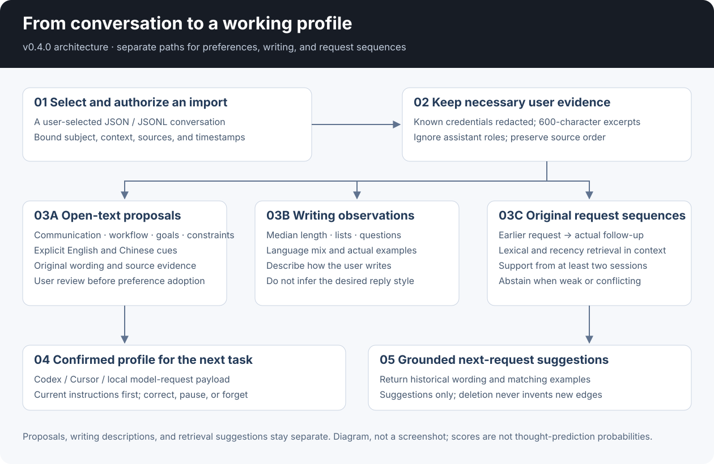
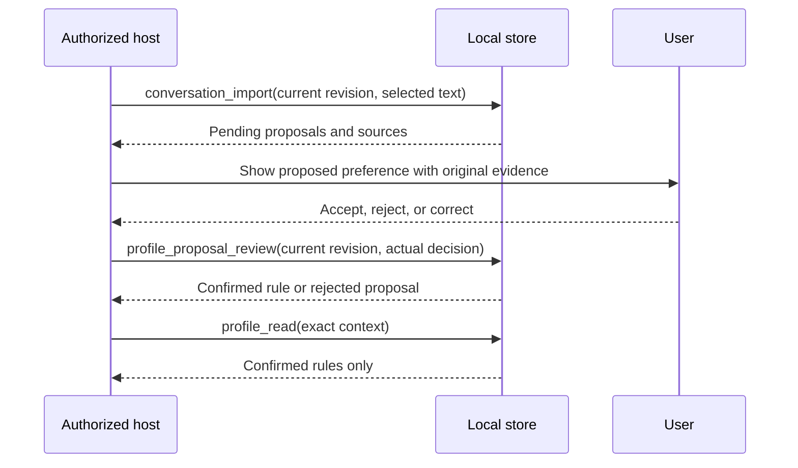
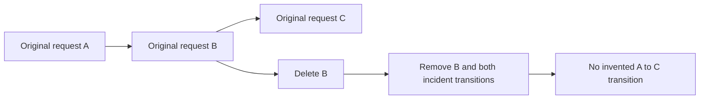

# Architecture — v0.4.0

[English](architecture.md) · [中文](architecture.zh-CN.md)

Conversation learning produces three distinct outputs: reviewable preferences, descriptive writing observations, and historical follow-up suggestions. They share source records but do not share the same meaning or adoption rules.

## From text to evidence

A host submits an authorized, chronological conversation with a fixed subject and context. The importer validates IDs, roles, timestamps, and size; masks known credentials and email patterns; then retains user excerpts, surface features, content hashes, and original request transitions. Assistant, system, and tool text is not stored as user evidence.

The store holds at most 400 user records and 80 sessions. Each retained excerpt is at most 600 sanitized characters; a message may be up to 4,000 characters at import. Features are computed from sanitized authored text after quoted/code spans are masked. Automatic explicit-cue extraction uses the retained excerpt, so a durable preference far into a long message can be missed. This boundary is visible rather than hidden behind a claim to analyze everything.

## Three branches

| Branch | Actual output | What uses it |
|---|---|---|
| Explicit-cue extraction | Open-text statements categorized as communication, workflow, goal, or constraint; exact source evidence | A user accepts or rejects a proposal before ordinary recall changes |
| Writing observation | Counts, median length, language mix, examples, and eligible recent/older window comparisons | Inspection and discussion; not automatic instructions to imitate |
| Request-sequence retrieval | A previous user request paired with its original next user request | `profile_forecast` matches a new request and ranks historical follow-ups |

The older six-dimension feedback subsystem still has its own independent-session and review rules. See [structured architecture](structured-architecture.en.md). Its three-session threshold does not apply to extracting an explicit statement from a conversation.

## Proposal review and correction

A model can assist through `profile_model_context` and `profile_model_propose`. It receives selected excerpts, returns proposed statements with exact quotes, and cannot confirm a rule. The local validator proves source correspondence and basic input constraints, not that a paraphrase is semantically correct. Human review remains the adoption step.

Free-text statements preserve custom vocabulary and detailed workflows. They also require deliberate conflict resolution: `replace_rule_id` identifies the old rule to correct. The adapter does not infer every contradiction between arbitrary sentences.

## How forecasts use history

The forecaster considers original same-session request transitions in the exact context. A transition spans at most 24 hours; usable history is bounded to 90 days. English word/subword and Chinese character channels provide lexical similarity, while recency weights newer examples more strongly. Each session contributes at most its best matching case. Similar follow-ups are grouped, and a representative is an actual retained user request.

A suggestion needs support from at least two sessions, recent evidence, and enough separation from alternatives. Weak or conflicting evidence causes abstention. Scores rank available cases; they are not calibrated probabilities, general semantic understanding, or predictions of private thoughts. The [frozen diagnostic](evaluation.md) reports coverage and misses.

## Deletion preserves real sequence boundaries

Deleting a message or conversation removes dependent proposals, accepted rules, writing contributions, and original transitions. A broader cascade can remove linked evidence needed to prevent a forgotten preference from reappearing. Minimal source hashes suppress old-message replay. Pausing stops ordinary reads and learning; reset clears content and ends paused.

## Storage and execution

The SQLite adapter is the runtime source of truth. Original Markdown templates remain an alternative host-managed format, not a second automatically maintained database. All writes use revision checks; concurrent or stale clients cannot silently overwrite a newer review. Host identity, consent, provider calls, and external backups remain separate integration responsibilities.

Stored → loaded → applied → helpful are different outcomes. Check the actual host response and user feedback after a preference is accepted; local code checks establish only their tested behavior.
