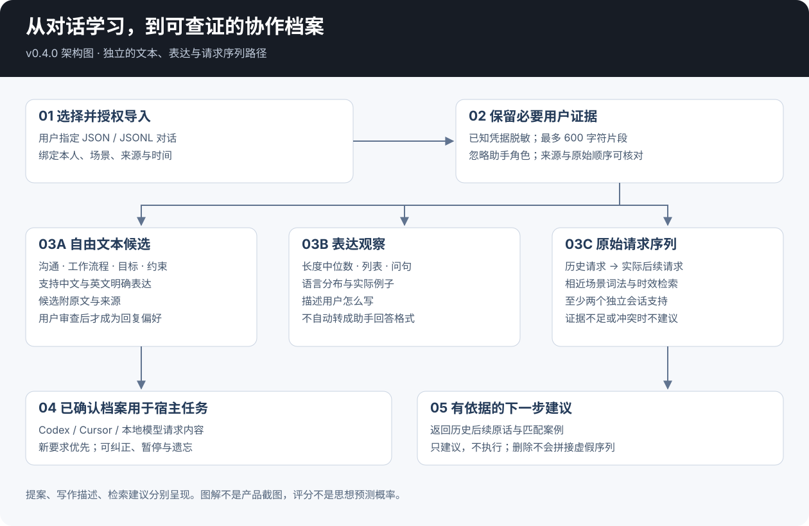
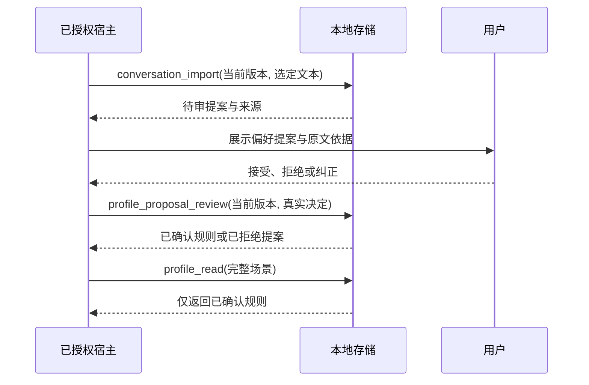
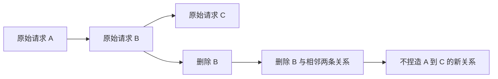

# 架构 — v0.4.0

[English](architecture.md) · [中文](architecture.zh-CN.md)

对话学习产生三类独立结果：待审偏好、表达观察、历史后续建议。它们共用来源记录，但含义和采用条件不同。

## 从文本到证据

宿主以固定本人和场景提交已授权、按时间排列的对话。导入器校验 ID、角色、时间和大小，清理已知凭据与邮箱模式，再保留用户片段、表面特征、内容哈希和原始请求前后关系。助手、系统和工具文本不作为本人证据存储。

最多保留 80 个会话、400 条用户记录。每条导入消息最多 4,000 字符，保留片段最多为清理后的 600 字符；表达特征从清理后的本人文本计算，引用和代码先被屏蔽。自动明确表达提取使用保留片段，所以长消息后半段的偏好可能漏掉。这个边界会明确呈现，不声称分析了全部内容。

## 三条分支

| 分支 | 实际结果 | 如何使用 |
|---|---|---|
| 明确表达提取 | 沟通、工作流程、目标或约束等自由文本，附原文证据 | 本人接受或拒绝后，才改变普通检索 |
| 表达观察 | 计数、长度中位数、语言分布、例子及满足条件的近期/旧期比较 | 用于查看讨论，不自动要求模仿 |
| 请求序列检索 | 原始用户请求与其实际下一条用户请求 | `profile_forecast` 匹配新请求，排列历史后续案例 |

旧版六维反馈仍有独立的会话计数和确认规则，见[结构化架构](structured-architecture.zh-CN.md)。其三个会话门槛，不用于从对话中提取一句明确陈述。

## 提案审查与纠正

模型可通过 `profile_model_context` 与 `profile_model_propose` 辅助，读取选择的片段，返回带精确引文的提案，但不能直接确认规则。本地校验能证明来源对应、基本输入合法，不能证明改写的语义正确；本人审查仍是采用步骤。

自由文本可以保留专用词和详细流程，也需要明确解决冲突。`replace_rule_id` 指定被纠正的旧规则，适配器不会自动识别任意两句话之间的所有矛盾。

## 后续建议怎样使用历史

检索只考虑完整场景内、同会话原本发生的前后请求。两条请求间隔最多 24 小时，可用历史限定为 90 天。英文词与子词、中文字符通道计算词法相似度，时间权重偏向较近案例。一个会话最多贡献最佳匹配；相近后续请求分组后，选择真实保留的原话作为代表。

提出建议需要至少两个会话、近期证据和足够明显的领先程度；证据不足或相互冲突时暂不建议。分数只排列已有案例，不是校准概率、通用语义理解或私密思想预测。[冻结诊断](evaluation.zh-CN.md)单独报告覆盖率和漏检。

## 删除保留真实序列边界

删除消息或会话，会移除依赖它的提案、已确认规则、表达贡献和原始关系。为防止已遗忘偏好重新出现，可能连带清理关联证据。最小来源哈希用于抑制旧消息重放。暂停停止普通读取与学习，重置清空内容并保持暂停。

## 存储与实际执行

SQLite 适配器是运行时的唯一状态来源。原有 Markdown 模板仍可用于另一种宿主自管方案，不是自动维护的第二个数据库。写入检查版本，防止并发或旧客户端悄悄覆盖新审查。身份、同意、提供方调用和外部备份是独立的宿主职责。

保存 → 加载 → 实际采用 → 有帮助，是不同结果。确认偏好后还需检查真实模型回答与用户反馈；本地检查只证明其实际覆盖的行为。
