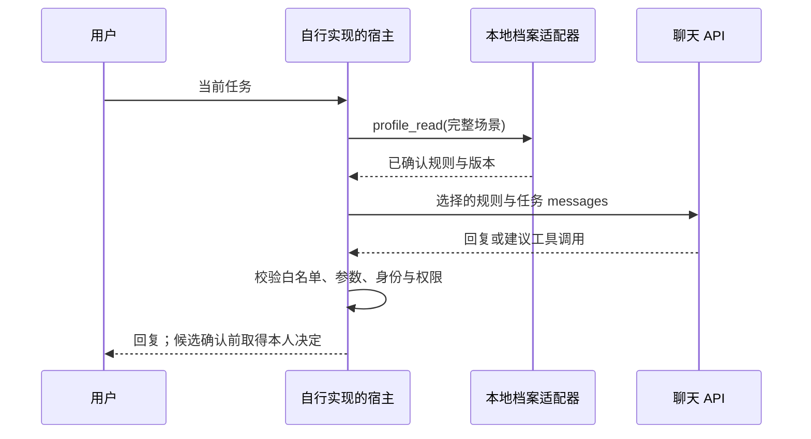

# 宿主接入 — v0.3.0

[English](host-integration.md) · [中文](host-integration.zh-CN.md)

## 本地 CLI 与 MCP

`scripts/host.py` 提供 [README](../README.zh-CN.md) 中的十个工具，CLI `call` 与 MCP stdio 共用实现和输入校验。subject 在进程启动时绑定，工具参数不能切换用户。操作者取得授权后，使用 `--enable-observations` 开启观察路径。

宿主负责身份核实、已授权消息、真实来源与会话编号、明确审查决定和当前场景。适配器不爬取历史，也无法证明传入的 `source_id` 是真实同意收条。工具能调用，不等于可以随意收集反馈。

## Codex 与 Cursor

安装助手为 Codex 写入 `.codex/config.toml`，为 Cursor 写入 `.cursor/mcp.json`，保留已有配置并拒绝重名服务。条目绑定 Python、包路径、私有根和用户。两者指向同一数据根与 subject 时，可以在同一台机器读取相同的已提交档案。

Skill 是供宿主读取的指导。Codex 的 `AGENTS.md` 和 Cursor 项目规则是另外的指令机制；安装 MCP 不会改写它们，也不保证每轮都调用工具。Cursor 项目规则使用 `.cursor/rules` 下的 `.mdc`，普通 Markdown 文件不等同于规则。请核对现行 [Codex 说明](https://developers.openai.com/codex/guides/agents-md)与 [Cursor 规则](https://cursor.com/docs/rules)。

`scripts/run_host.py` 在新的 CLI 调用前加载已确认偏好。元数据收条区分已加载的版本、规则 ID 和宿主真实退出结果，输出流向终端。它不会为已运行的桌面聊天创建计时器或逐轮钩子；宿主仍需自己的账号、模型权限和可用 CLI。

## DeepSeek 与其他聊天 API

`scripts/build_context.py` 生成含 `messages` 与本地元数据的请求内容，不执行发送。客户端自行选择提供方支持的模型，按当前 API 规范发送 `messages`。密钥留在客户端，不进入档案或公开仓库。

DeepSeek JSON Output 约束的是输出格式，不能证明抽取的偏好真实。自行开发的工具桥接必须校验类型和枚举，仅接受已授权用户消息白名单中的来源，拒绝空白或截断输出，保留版本检查，并只发送必要内容。不要将隐藏推理或助手输出当成用户证据。参见[官方 JSON Output 文档](https://api-docs.deepseek.com/guides/json_mode/)。

本版本没有提供自动运行的 DeepSeek 工具循环或模型驱动的历史抽取器。本地请求内容生成成功，不等于 DeepSeek 在线接入验收通过。

## 宿主仍需负责的能力

身份提供方、历史采集、会话结束事件、后台反思、加密和系统权限、提供方留存、群聊披露及多设备同步，均需要独立实现和验收。[原有反思协议](../references/reflection-workflow.md)说明宿主如何提供这些能力，并不是已经运行的服务。

可复现本地调用见[教程](tutorial.zh-CN.md)，验收范围见[验收指南](evaluation.zh-CN.md)。

## 本地进程可见性

Codex 通过 stdin 接收组合后的提示。当前 Cursor CLI 路径使用位置参数，同一系统用户运行的其他工具可能在进程参数中看到内容。如不能接受这层暴露，应使用 MCP 路径或合适的本地账号隔离。输出仍可能被终端或宿主记录；适配器只留元数据，并不会删除那些独立副本。
