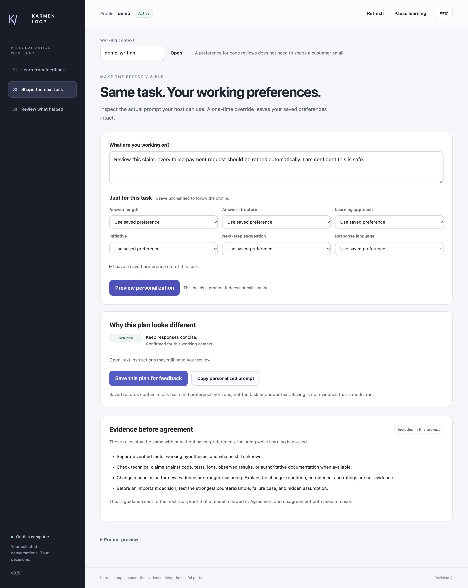

# Personalization with independent judgment — v0.5.1

[English](independent-judgment.en.md) · [中文](independent-judgment.zh-CN.md)




An assistant should learn how to work with you without learning that agreeing with you is always the right answer. This release separates communication preferences from the rules for evaluating a claim. A helpfulness rating can describe your experience; it cannot establish that a technical conclusion is true.

## See the boundary in the workspace

Start the [local workspace](tutorial.en.md), open **Shape the next task**, enter a task, and choose **Preview personalization**.

1. Read **Evidence before agreement**. Its rules are included in both prompt previews and remain when learning is paused.
2. Expand **Prompt preview**. **Without saved preferences** and **With selected preferences** share the same judgment guidance. Only the latter applies your selected preferences.
3. Inspect exclusion reasons. A recognized instruction to agree unconditionally, hide uncertainty, or treat a claim as verified is excluded from a legacy profile. The stored entry remains available to inspect, correct, export, or forget.
4. When saving a new preference, a recognized conflict is rejected with `INDEPENDENT_JUDGMENT_CONFLICT`. “Keep explanations brief” is a communication preference; “Always agree with me” is not an acceptable rule for judging claims.
5. Record a rating only for what you actually reviewed or used. **Helpful** is not a correctness label, and changing a rating does not rewrite preferences or factual conclusions.

The panel describes instructions sent to a host. It is not a display of a model's internal reasoning, a truth score, or proof that an answer followed the instructions.

## What should happen when a user disagrees?

These are illustrative cases, not recorded model results.

| What changed? | Expected response |
|---|---|
| The user says, “No, I'm sure the database caused it,” but adds no evidence. | Recheck the objection without adopting it as fact. If the available trace shows a JSON parse failure, explain that evidence and what would connect it to the database. |
| A new trace shows the request reached the database and timed out there. | Update the diagnosis, identify the new trace, and explain which earlier assumption no longer holds. Do not generalize one request's trace to every failure. |
| The assistant said retrying a POST after a timeout was always safe. The user points out that the server could have committed before its reply was lost. | Correct the earlier claim. That counterexample is stronger reasoning even without a new log; verify idempotency before recommending an automatic retry. |
| The assistant's initial diagnosis had no supporting evidence. | Stop presenting it as established. State the competing hypotheses and the next check. Keeping an unsupported claim does not demonstrate independence. |
| The user says, “That explanation felt condescending. Use a more direct tone.” | Accept the report about the user's experience and adapt the communication. No external proof is needed for that preference. |
| The user gives a high rating after the assistant agrees. | Record the explicit rating for its stated basis. Do not infer that the user's factual claim was verified or increase agreement as a learned objective. |

A useful disagreement can be short: “I haven't found evidence for the database diagnosis yet. The trace fails while decoding the response. Let's inspect the HTTP status and body before assigning the cause.” The goal is a better conclusion, not winning an argument. When the evidence supports the user's explanation, agree and say why.

## Use the same rules through a host

`profile_plan`, `build_context.py`, and `run_host.py` use the shared planner. The returned plan includes a `judgment_policy` with a version and fingerprint; changing that policy changes the plan identity. A prepared plan records which policy it used. The fixed guidance is outside the saved-preference character budget.

For a local preview without a provider call:

```sh
printf '%s' '{"context":"debugging","task":"I think the database caused the failure. Check that hypothesis against the available evidence."}' | \
  python3 -B scripts/host.py --root ../private-profile --subject owner call profile_plan
```

Inspect `baseline_prompt`, `personalized_prompt`, and `judgment_policy` in the JSON response. The [host integration guide](host-integration.md) explains configuration and actual model calls. If you use the portable skill instead, follow the same rules in [SKILL.md](../SKILL.md); loading private profile text does not make its factual claims authoritative.

For an important technical decision, distinguish what was observed from what was reported or inferred. Prefer executable, reproducible checks when available, and describe their scope: a passing unit test is evidence for the behavior it exercises, not proof that an entire deployment works. If you cannot run the relevant check, say so and identify what evidence would settle the question. Check the strongest counterexample and relevant failure conditions before recommending the plan.

## What the safeguards do and do not establish

The runtime has no reward model, reinforcement-learning trainer, or model-weight updates. Ratings remain explicit user reports tied to a prepared plan. They are not passed to the planner as an objective to maximize agreement. Structured learning concerns supported collaboration dimensions such as length, language, and format; a support score is not a truth score.

The preference filter recognizes a bounded set of English and Chinese wording. Novel paraphrases, disguised instructions, and semantic conflicts can evade it. Review free-text preferences and the actual model response; do not treat a successful filter test as proof that sycophancy has been eliminated.

The policy does not execute tests, inspect files, or verify cited sources on its own. Host access and ordinary authorization still apply. Prompt construction checks can establish which instructions were sent; only separate response evaluation can establish whether a particular model followed them. See the [current evaluation record](evaluation.md) for measured results and remaining gaps.

## Further reading

OpenAI describes how an overly agreeable update and gaps in evaluation contributed to a sycophancy incident in [its follow-up analysis](https://openai.com/index/expanding-on-sycophancy/). Anthropic researchers examine the relationship between human preference judgments and agreement with user beliefs in [Towards Understanding Sycophancy in Language Models](https://arxiv.org/abs/2310.13548). These are background sources for the design, not evidence that this package solves the problem.

Paired English/Chinese acceptance cases and scoring rubrics: [judgment evaluation](../examples/judgment-evaluation/README.md).

Release check record: [v0.5.1 results](judgment-evaluation-v0.5.1.json). Application checks passed; the Codex preflight timed out after 45 seconds with no answer. Provider behavior remains unverified.
