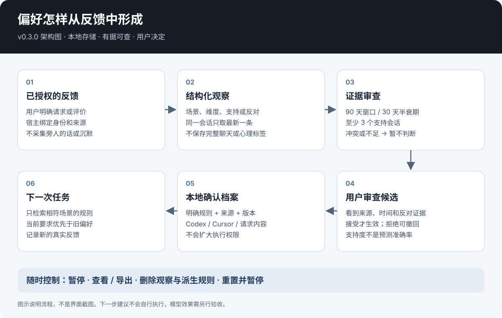
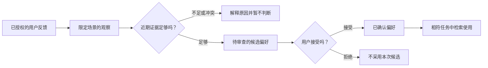

# v0.3.0 介绍存档

这是已合入的中间源码记录，不是已发布的 v0.3.0 发行版。没有发布 v0.3.0 标签或安装包；下方旧下载链接改指向 PR #6。

历史记录：结构化反馈适配器早于当前的对话学习实现。请使用[现行教程](tutorial.zh-CN.md)。

# 用户行为个性化

[English](../README.md) · [中文](../README.zh-CN.md) · **v0.3.0**

[](https://github.com/KarmenLoop/user-behavior-personalization/actions/workflows/checks.yml)
[](https://github.com/KarmenLoop/user-behavior-personalization/releases/latest)
[](../LICENSE)

你可能希望进度汇报简短、代码审查充分。助手需要记住这种区别，也需要知道什么时候该重新问你。

这个项目为本地 Agent 宿主提供一份共享、可查看的偏好档案：保存用户明确表达的习惯，接收已授权的反馈，整理待确认的规律，再在合适的任务里使用。每次变更都有来源；从行为中归纳出的偏好，必须经用户确认才会长期生效。

由 [KarmenLoop](https://github.com/KarmenLoop) 开发。使用 Python **3.11+** 标准库、SQLite、CLI 和 MCP stdio。本地流程无需模型权重、云账号或 API 密钥。



[下载 v0.3.0](https://github.com/KarmenLoop/user-behavior-personalization/pull/6) · [开始使用](../docs/tutorial.zh-CN.md) · [20 个常见问题](../docs/faq.zh-CN.md) · [研究与设计依据](../docs/research.zh-CN.md)

## 0.3.0 增加了什么

| 能力 | 实际可以做什么 |
|---|---|
| 从反馈积累证据 | 接收跨独立会话的结构化观察，重复导入同一来源不会增加支持度。 |
| 解释建议的来由 | 查看支持与反对证据、时间、场景，以及为什么建议确认或暂不判断。 |
| 自己决定是否采用 | 接受或拒绝候选偏好；只有接受后才进入生效规则。 |
| 区分任务场景 | 使用 `status-update`、`code-review` 等完整标签，也可明确设置全局默认值。 |
| 调整教学方式 | 根据真实反馈和用户选择，提供例题、练习或“用自己的话解释一遍”。 |
| 建议下一步 | 整理特定场景下的下一步偏好，例如实现后先测试；建议本身不会执行操作。 |
| 纠正和删除记忆 | 支持更正、暂停、导出、删除观察及派生规则，以及重置档案。 |
| 在不同宿主使用 | Codex 和 Cursor 可共享本地档案；也能生成供 DeepSeek 类聊天 API 使用的偏好请求内容。 |

行为学习需要主动开启。当前使用六类有限维度、最多 200 条观察、90 天证据窗口和时间衰减。这些是可检查的产品规则，不是经过验证的人格量表，也不代表“猜中想法”的概率。

## 一个具体例子

**原来的问题：** 用户某次要短回答，助手就认定他永远不喜欢细节。

**这里的做法：** “这次汇报简单点”只约束当前任务。三个独立会话里的已授权反馈，可以形成 `status-update` 场景的候选偏好。系统展示依据，由用户决定是否保留；同时，`code-review` 仍然可以要求充分展开。



## 安装并试用

下载发行压缩包，核对 `SHA256SUMS.txt` 后解压。在解压目录内运行：

```sh
python3 --version
python3 -B scripts/check_package.py
python3 -B scripts/host.py --root ../private-profile --subject demo \
  call profile_read --input examples/requests/read-code-review.json
```

最后一条命令使用合成用户，在包外的私有目录读取档案，不需要模型、密钥或聊天历史。[完整教程](../docs/tutorial.zh-CN.md)会带你走完读取 → 保存 → 观察 → 确认 → 再次使用 → 遗忘。

为已有项目添加 MCP 服务：

```sh
python3 scripts/host.py --root ../private-profile --subject owner \
  --workspace /path/to/project --enable-observations --install-host codex install
```

Cursor 使用 `--install-host cursor`。重新加载宿主、批准这个服务，再检查工具是否可用。写入配置不代表模型会话已接通。宿主仍需把 subject 绑定到正确用户，并在记录反馈前取得授权。

## 十个工具，一份本地档案

| 工具 | 用途 |
|---|---|
| `profile_read` | 读取完整场景标签或全局 `*` 范围内的已确认规则。 |
| `profile_correct` | 带来源和当前版本，保存明确偏好或更正。 |
| `profile_observe` | 在观察已开启时，记录一条获授权的结构化反馈。 |
| `profile_insights` | 解释候选规律和证据缺口，不直接采用。 |
| `profile_review` | 用新的确认来源，接受或拒绝现行候选。 |
| `profile_pause` | 暂停普通检索与学习，直到恢复。 |
| `profile_forget` | 删除规则、受控历史及关联学习证据。 |
| `profile_forget_observations` | 删除指定观察及依赖它们形成的规则。 |
| `profile_export` | 查看或导出私有档案；暂停期间仍可操作。 |
| `profile_reset` | 清空档案内容，保留防重放哈希，并暂停档案。 |

写操作校验版本，因此过时的客户端不能悄悄覆盖新纠正。偏好不会增加执行权限，当前用户要求与宿主的指令优先级始终有效。

## 接入方式与验收范围

| 路径 | 包中已提供 | 仍需单独验收 |
|---|---|---|
| 本地 CLI / MCP | 存储、校验、学习、审查及隐私操作 | 身份映射和授权 |
| Codex / Cursor | 项目 MCP 配置助手、调用前加载包装入口 | 各宿主的登录、版本、权限与真实模型回复 |
| DeepSeek 类聊天 API | `build_context.py` 生成带限定偏好的请求内容 | HTTP 客户端、密钥、工具调用循环、提供方策略及真实返回 |

本项目没有后台历史爬虫、常驻监听、跨设备同步服务或模型微调。它不能读取思想、诊断心理状态，也不能保证完全理解一个人。[验收指南](../docs/evaluation.zh-CN.md)区分了本地测试、宿主实际调用和真实用户收益。

## 文档导航

| 内容 | 中文 / English |
|---|---|
| 下载、安装、配置、使用与排错 | [教程](../docs/tutorial.zh-CN.md) / [Tutorial](../docs/tutorial.en.md) |
| 数据流、审查与删除图解 | [架构](../docs/architecture.zh-CN.md) / [Architecture](../docs/architecture.md) |
| Codex、Cursor 与模型 API 接入 | [宿主接入](../docs/host-integration.zh-CN.md) / [Hosts](../docs/host-integration.md) |
| 授权、存储、导出与删除 | [隐私控制](../docs/privacy-and-memory-control.zh-CN.md) / [Privacy](../docs/privacy-and-memory-control.md) |
| 学习方法与独立实现 | [研究依据](../docs/research.zh-CN.md) / [Research](../docs/research.en.md) |
| 二十个实际使用问题 | [常见问题](../docs/faq.zh-CN.md) / [FAQ](../docs/faq.en.md) |
| 如何判断确实可用 | [验收](../docs/evaluation.zh-CN.md) / [Evaluation](../docs/evaluation.md) |

[v0.2.0 介绍](../docs/overview-v0.2.0.zh-CN.md)及旧图保留为历史记录。升级时请注意：场景匹配改为完整标签、忽略大小写，`art` 不再匹配 `cartography`；已有明确偏好仍能读取。旧版未绑定用户的包装入口日志，需要单独检查和清理。

## 许可与支持

使用 [Apache-2.0](../LICENSE)。实现与图解由 KarmenLoop 原创。引用材料用于说明设计依据，包内不含其他记忆引擎或外部模型权重。提及产品名称不代表合作或背书。

[参与贡献](../CONTRIBUTING.md) · [支持](../SUPPORT.md) · [安全](../SECURITY.md) · [KarmenLoop](https://karmenloop.com)
