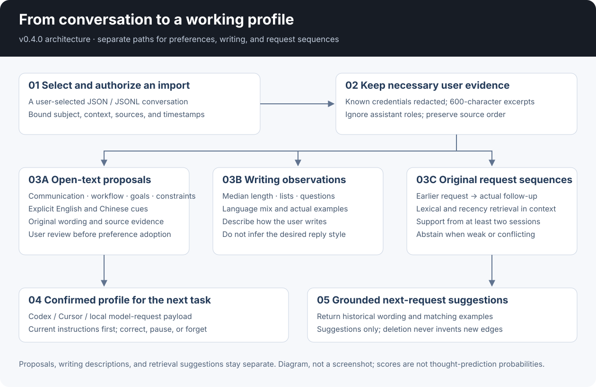
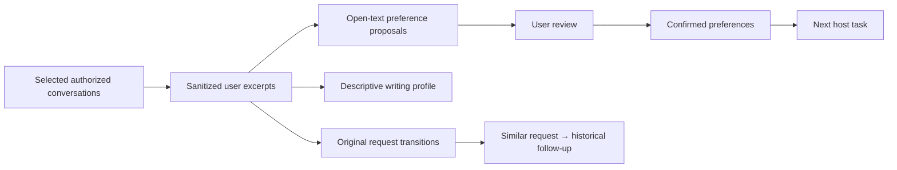

# Archived v0.4.0 overview

This is the published v0.4.0 source snapshot. Use the [current tutorial](tutorial.en.md) for the v0.5.0 workspace.

# User Behavior Personalization

[English](../README.md) · [中文](../README.zh-CN.md) · **v0.4.0**

[](https://github.com/KarmenLoop/user-behavior-personalization/actions/workflows/checks.yml)
[](https://github.com/KarmenLoop/user-behavior-personalization/releases/latest)
[](../LICENSE)

Learn from what a person actually says: their preferred explanations, project terminology, recurring workflows, and stated goals.

User Behavior Personalization imports conversations you select, finds explicit preferences in English and Chinese, and builds an inspectable working profile. It also describes writing patterns and retrieves what the user asked for after similar requests in earlier sessions. You can inspect each source, correct a proposal, and remove the conversation that produced it.

Built by [KarmenLoop](https://github.com/KarmenLoop). Python **3.11+**, standard library, private SQLite, CLI and MCP stdio. The local learning path needs no model account or API key.



[Download v0.4.0](https://github.com/KarmenLoop/user-behavior-personalization/releases/tag/v0.4.0) · [Complete tutorial](../docs/tutorial.en.md) · [20 practical questions](../docs/faq.en.md) · [Research](../docs/research.en.md)

## From manual labels to conversation learning

| Before: structured feedback | Now: selected conversation text |
|---|---|
| The host supplied one of six predefined dimensions. | Import user messages; extract open-text communication preferences, workflows, goals, and constraints. |
| A next-step preference chose from a fixed action list. | Retrieve actual follow-up requests from similar historical request sequences. |
| A profile mostly listed saved rules. | Inspect confirmed preferences, pending proposals, writing features, sources, and examples together. |
| The host had to phrase every observation. | A conservative bilingual extractor finds explicit cues; an optional host-model bridge can propose additional interpretations with exact source quotes. |

The original structured-feedback path remains available. The new conversation path requires its own `--enable-conversations` setting; enabling one does not enable the other.

## What a conversation can teach it

| User message | Reviewable result |
|---|---|
| “From now on, include a rollback checklist in release plans.” | A custom workflow preference for the current project context. |
| “Please remember: call our staging environment rehearsal.” | Project terminology in the user's own words. |
| “My goal is to learn enough SQL to inspect product metrics.” | A stated learning goal, kept separate from an inferred ability level. |
| “以后写方案时，先给我能执行的步骤，再解释取舍。” | An open-text Chinese preference, without translating it into a small fixed label set. |

Direct language such as “I prefer,” “from now on,” “my goal is,” and their supported Chinese equivalents can produce proposals. Quoted examples, code, temporary requests, and recognized sensitive content are excluded from automatic preference extraction. This is a conservative rule-based extractor, not a general understanding model; see the [evaluation results and limits](../docs/evaluation.md).

## Three useful views of the same evidence

**Working profile.** `profile_portrait` separates confirmed preferences from pending proposals. It shows descriptive writing features such as median message length, lists, questions, and language mix, with source excerpts. How someone writes is not automatically how they want an assistant to reply.

**Experimental next-request suggestions.** `profile_forecast` compares a current request with earlier requests in the same context. It returns original follow-up wording, supporting sessions, and matching examples—or abstains. It uses independently implemented lexical and recency scoring, not six canned actions or a probability of reading someone's thoughts.

**Confirmed response context.** Accept a proposal, then `profile_read`, the CLI wrapper, or `build_context.py` can load it for an appropriate task. Pending proposals and writing statistics are not silently adopted as instructions.



## Try a real local import

Download the ZIP, verify `SHA256SUMS.txt`, and extract it. From that directory:

```sh
python3 -B scripts/check_package.py
python3 -B scripts/learn_conversation.py --root ../private-profile --subject demo \
  --enable-conversations --input examples/conversations/sample.en.json
```

The command imports the sample through the actual adapter and prints the resulting portrait. It stages proposals; it does not confirm them for you. The [tutorial](../docs/tutorial.en.md) covers your own JSON/JSONL files, review, correction, forecasts, host setup, and deletion.

Connect a project to Codex or Cursor:

```sh
python3 scripts/host.py --root ../private-profile --subject owner \
  --workspace /path/to/project --enable-conversations --install-host codex install
```

Use `--install-host cursor` for Cursor. Bind the real user in the host configuration, approve the specific server, and verify actual tool calls. DeepSeek-style APIs can use locally generated context through your own client; the package does not make an automatic provider call.

## Eighteen local tools

| Purpose | Tools |
|---|---|
| Learn from selected conversations | `conversation_import`, `profile_proposal_review`, `profile_forget_conversation`, `profile_forget_messages` |
| Inspect and anticipate | `profile_portrait`, `profile_forecast` |
| Use an optional host model | `profile_model_context`, `profile_model_propose` |
| Save and load explicit rules | `profile_read`, `profile_correct` |
| Use structured feedback | `profile_observe`, `profile_insights`, `profile_review`, `profile_forget_observations` |
| Control the profile | `profile_pause`, `profile_forget`, `profile_export`, `profile_reset` |

Writes require the current revision. Correct an accepted proposal with a genuinely new source, or delete its source conversation and the dependent content. Deleting the middle message in a sequence never invents a new link between its neighbors.

## Scope and current limits

The store retains up to 400 user records across 80 sessions. Each record keeps up to 600 sanitized excerpt characters plus features and source hashes. Known credential and email patterns are redacted; this is not a complete personal-data detector. Assistant, system, and tool messages are not stored as user evidence. Import is explicit, with no background crawler or screen monitoring.

Forecasting is experimental and works best when wording is close. On a new 18-query synthetic holdout, it correctly suggested 4 of 12 expected positive cases and abstained on the other 8; all 6 negative cases abstained. English positive coverage was 0/6, Chinese 4/6. This is a small diagnostic, not a general accuracy estimate. Forecasting needs evidence from at least two sessions and can miss paraphrases or unfamiliar topics. Its scores rank historical cases; they are not calibrated probabilities. Local correctness tests and the small frozen diagnostic are reported separately from actual model behavior. Current host/provider acceptance is documented in [evaluation](../docs/evaluation.md), including unsuccessful attempts.

## Documentation

| Topic | English / 中文 |
|---|---|
| Download → import → review → use → delete | [Tutorial](../docs/tutorial.en.md) / [教程](../docs/tutorial.zh-CN.md) |
| Conversation, profile, and forecast diagrams | [Architecture](../docs/architecture.md) / [架构](../docs/architecture.zh-CN.md) |
| Codex, Cursor, and optional model bridge | [Host integration](../docs/host-integration.md) / [宿主接入](../docs/host-integration.zh-CN.md) |
| Storing excerpts, retention, and deletion | [Privacy](../docs/privacy-and-memory-control.md) / [隐私控制](../docs/privacy-and-memory-control.zh-CN.md) |
| Research and psychology-informed teaching | [Research](../docs/research.en.md) / [研究依据](../docs/research.zh-CN.md) |
| Twenty concrete usage questions | [FAQ](../docs/faq.en.md) / [常见问题](../docs/faq.zh-CN.md) |
| Diagnostics, failures, and acceptance | [Evaluation](../docs/evaluation.md) / [验收](../docs/evaluation.zh-CN.md) |
| Original structured-feedback workflow | [Guide](../docs/structured-feedback.en.md) / [指南](../docs/structured-feedback.zh-CN.md) |

Historical [v0.2.0](../docs/overview-v0.2.0.en.md) and [v0.3.0](../docs/overview-v0.3.0.en.md) overviews remain available. Existing profiles stay readable; there is no model retraining or cross-device sync service.

## License and support

[Apache-2.0](../LICENSE). Original implementation and diagrams by KarmenLoop. Research references explain design choices; their benchmark results are not this project's results.

[Contributing](../CONTRIBUTING.md) · [Support](../SUPPORT.md) · [Security](../SECURITY.md) · [KarmenLoop](https://karmenloop.com)
