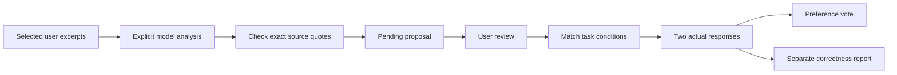
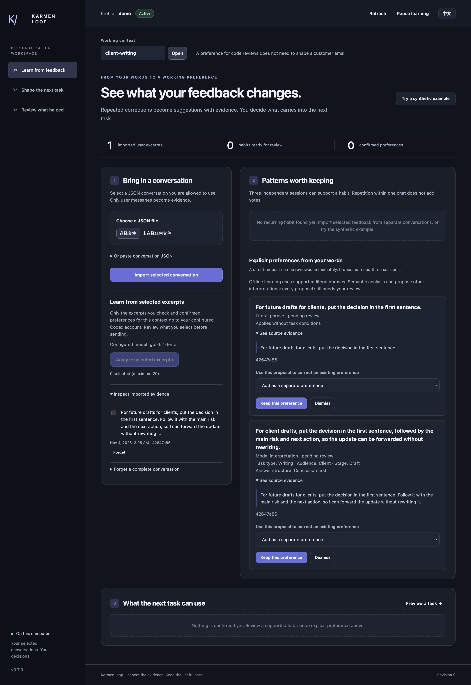
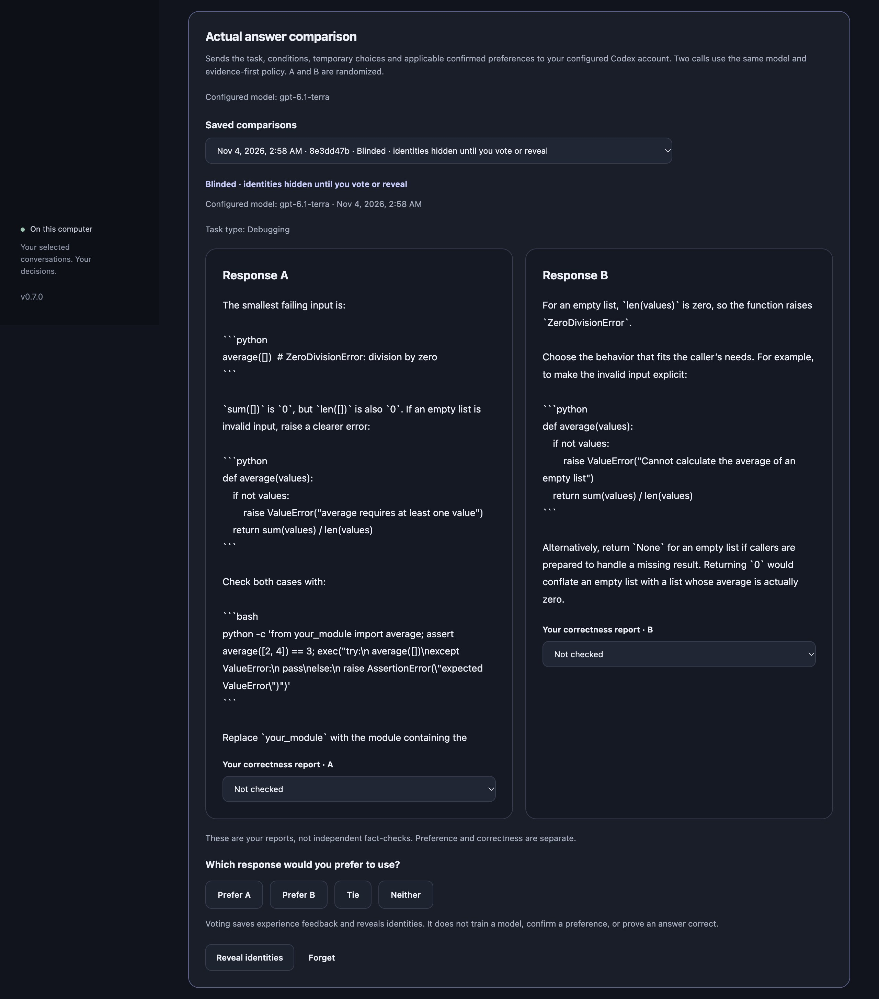
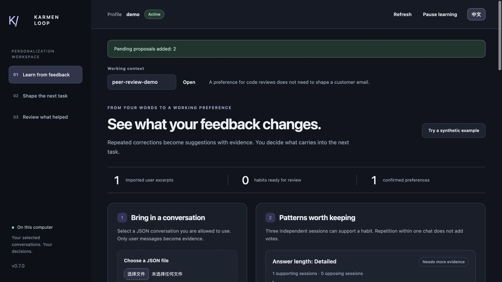

# Selected evidence, conditional preferences, and real comparisons — v0.7.0

[English](semantic-learning.en.md) · [中文](semantic-learning.zh-CN.md)

The workspace keeps the existing offline learning path. Semantic analysis and actual answer comparisons require explicit model access. They use your configured Codex CLI account; they do not train model weights or approve preferences automatically.


## Follow the evidence



The source quote explains where a proposal came from. The review decides whether it should become a preference. A later vote evaluates the experience; it does not approve another rule.

## Start the workspace

Use Python 3.11+ on macOS/Linux, or 3.12+ on Windows for these optional model workflows. The offline adapter supports 3.11+ on all platforms. Use an authenticated compatible Codex CLI and select the model you intend to use. Keep the private profile outside this repository:

```sh
python3 scripts/workspace.py --root /absolute/private/profile --subject me \
  --enable-conversations --enable-models --model YOUR_MODEL
```

Open the local URL printed by the command. If your setup needs the system proxy, add `--system-proxy`. `--model-timeout 90` sets the per-call timeout. Omit `--enable-models` for an offline workspace. Import and refresh never start a model call.

## Choose what leaves the computer

1. In **Learn from feedback**, choose a working context and import a conversation JSON you are allowed to use. The existing [conversation guide](conversation-guide.en.md) describes the format and limits.
2. Inspect the imported excerpts. Check 1–20 user messages for semantic analysis. Nothing is checked by default.
3. Read the disclosure and configured model. **Analyze selected excerpts** sends only those excerpts and confirmed preferences for the current context to your configured Codex account. A complete account history is not sent.
4. Wait for the actual request to finish. Pause and refresh remain available while it runs. A failed request does not become a successful learning result. The model may return no proposal.

Offline learning recognizes supported literal phrases. Semantic analysis can interpret indirect feedback but can also misunderstand it. Neither the way you write nor repeated wording proves that you want the assistant to write the same way.

## Review the proposal and its conditions

A pending proposal shows its statement, exact source quotes, conditions, and dimension when present. Read the quote and judge the interpretation. An exact quote supports provenance; it does not prove that the proposed meaning is right.

Keep a proposal, dismiss it, or deliberately select an existing preference to correct with it. Before approval, the workspace lists the exact saved preferences that will be superseded, including their IDs, scope and conditions. A typed proposal updates peers with the same dimension, context and normalized conditions even with the default choice; the action says **Update existing preferences** / **Approve update**. Original versions remain in history. **Add as a separate preference** appears only when no existing preference will be superseded. Selecting an explicit correction target also previews that target and any matching typed peers. Model proposals are never active before your review. Use **Correct** on a saved preference to edit its wording and task conditions. Existing expiry is retained; expired records remain visible for correction or deletion.

Conditions are optional:

| Field | Choices |
| --- | --- |
| Task type | Coding, debugging, writing, learning, planning, status update |
| Audience | Self, team, client, public |
| Stage | Explore, draft, review, deliver |

An unspecified task condition does not match a rule requiring that condition. A matching context preference outranks a global peer. Within the same context priority, more specific matching conditions win. Conflicting typed values at equal specificity are left out. Prompt preview explains the exclusions. Temporary task choices and omissions leave saved preferences intact.

## Compare actual answers

1. Confirm at least one preference that applies to the task.
2. In **Shape the next task**, enter the task, choose its conditions, and adjust any temporary settings. **Preview personalization** shows prompts without calling a model.
3. Read the transmission disclosure, then select **Compare actual answers**. The task, conditions, temporary choices, and applicable confirmed preferences go to the configured account. Both calls use the same model and evidence-first policy. Only saved preference application differs.
4. Read responses A and B. Their identities and invocation order are randomized; A does not mean baseline. A complete comparison is saved only after both actual responses finish and the captured profile revision remains valid.
5. Choose A, B, tie, or neither. Report correctness separately for each answer: not checked, reported correct, or reported incorrect. These are your reports, not independent fact-checks.

A vote saves experience feedback and reveals the identities. **Reveal identities** can reveal them before voting; later votes are explicitly unblinded. Saved comparisons can be reopened. Revealed records show the selected preferences and actual execution metadata. No automatic quality score is assigned. A preferred answer is not necessarily a correct answer, and a vote is not a training reward.

## Pause and forget

Pause hides evidence, preferences, and saved answers. A profile change during a model request causes late results to be discarded. It cannot retract data already transmitted. Refresh reloads the live profile; cached answers are cleared before being read again. Context changes cannot restore an old answer through a late browser response.

Use **Forget** and confirm deletion to remove a comparison's private answers and feedback. Forgetting a supporting source, preference, or plan also removes dependent comparisons. This does not delete data retained by an external provider or your original import file. See [privacy controls](privacy-and-memory-control.md) for the wider deletion boundary.

This walkthrough describes implemented workflows. Actual provider behavior, browser acceptance, release checks, and public delivery are separate acceptance steps. See the [roadmap](roadmap.en.md) for what remains planned.




*Current browser capture with a synthetic client-draft excerpt. The conditional model proposal is pending; it is not a confirmed user profile.*



*Actual Codex outputs for a synthetic Python task. Labels remain hidden; no preference vote or correctness report has been submitted in this capture.*




*Before approval, this real model proposal names the existing concise-review preference it will replace, with its context and conditions. The subsequent browser approval matched that preview and kept the old version in history. This is synthetic acceptance data.*
