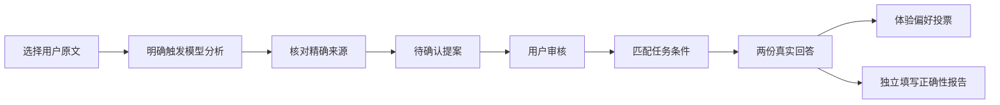
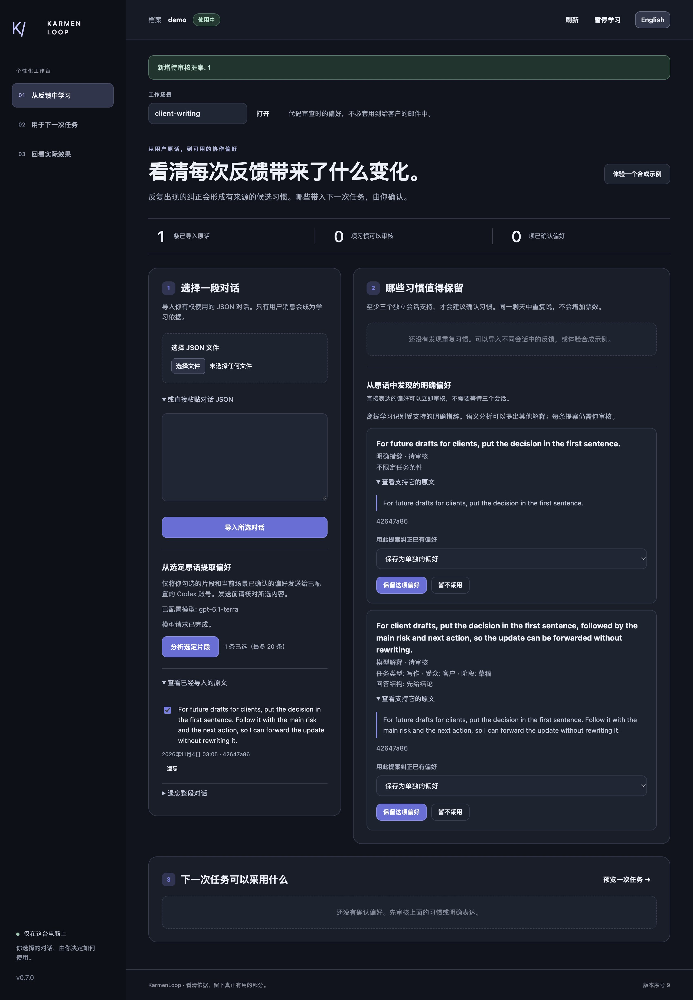
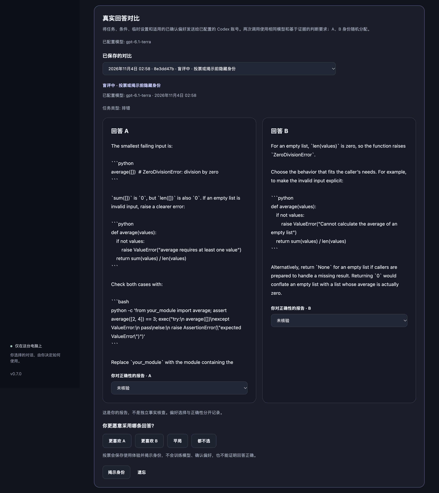
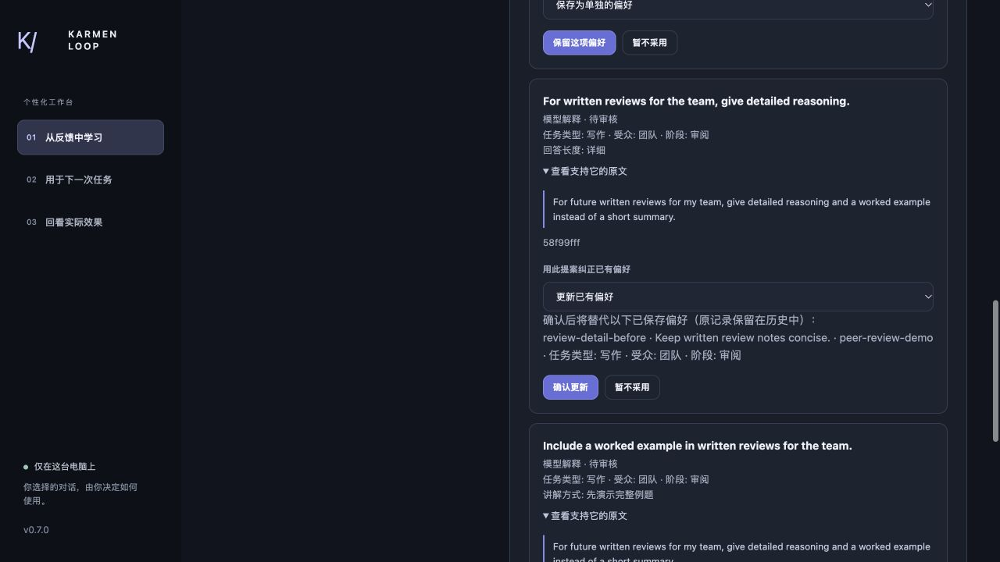

# 选定证据、条件偏好与真实回答对比 — v0.7.0

[English](semantic-learning.en.md) · [中文](semantic-learning.zh-CN.md)

工作台保留原有的离线学习方式。语义分析和真实回答对比需要明确开启模型访问，使用已配置的 Codex CLI 账号，不会训练模型权重，也不会自动确认偏好。


## 沿着证据走完一次



原文说明建议从何而来，审核决定是否把它保存为偏好。后续投票评价使用体验，不会自动批准另一条规则。

## 启动工作台

可选模型流程在 macOS/Linux 需要 Python 3.11+，Windows 需要3.12+；离线适配器在各平台仍支持3.11+。

先登录 Codex CLI，并选择实际要使用的模型。私有档案应放在仓库之外：

```sh
python3 scripts/workspace.py --root /absolute/private/profile --subject me \
  --enable-conversations --enable-models --model YOUR_MODEL
```

打开命令输出的本机地址。如需系统代理，添加 `--system-proxy`；`--model-timeout 90` 设置每次调用的超时秒数。不加 `--enable-models` 即为离线工作台。导入和刷新都不会自动调用模型。

## 选择哪些内容离开电脑

1. 在「从反馈中学习」中选择工作场景，导入有权使用的对话 JSON。[对话指南](conversation-guide.zh-CN.md)说明了格式和限制。
2. 检查已导入的原话，勾选 1 至 20 条用户消息用于语义分析。默认不勾选任何内容。
3. 核对发送说明和已配置模型，再点击「分析选定片段」。只发送所选片段和当前场景已确认的偏好，不发送整个账号的历史记录。
4. 等待真实请求完成。等待期间仍可暂停或刷新。请求失败不能算学习成功，模型也可能不给出任何提案。

离线学习识别受支持的明确措辞。语义分析能够解释部分间接反馈，也可能理解错误。你的表达方式或重复措辞，都不能证明你希望助手模仿同一种写法。

## 审核提案及其条件

待审核提案展示偏好内容、来源原话、条件和适用的维度。请对照原话判断解释是否成立。引用准确只能证明来源，不能证明理解正确。

你可以保留、忽略提案，或明确选择一条已有偏好，用提案纠正它。确认前，工作台列出将被替代的每条已有偏好，包括标识、场景与条件。带类型的提案即使使用默认选项，也会更新维度、场景和标准化条件相同的偏好，此时操作显示「更新已有偏好」和「确认更新」。原版本保留在历史中。只有不会替代已有偏好时才显示「保存为单独的偏好」。明确选择纠正对象时，也会预览该对象及同时匹配的带类型偏好。模型提案未经审核不会生效。已保存偏好的「纠正」允许编辑文字和任务条件，原有有效期会保留；过期记录仍可查看、纠正或删除。

任务条件可选：

| 字段 | 可选值 |
| --- | --- |
| 任务类型 | 编程、排错、写作、学习、规划、进展汇报 |
| 受众 | 自己、团队、客户、公众 |
| 阶段 | 探索、草稿、审阅、交付 |

任务未指定某个条件时，不会匹配要求该条件的偏好。匹配的场景偏好优先于全局同维度偏好；场景优先级相同时，条件更具体且匹配的偏好优先。同等具体的结构化偏好若值冲突，则暂不采用。提示词预览会解释排除原因。临时任务设置和单次排除不会改写已有偏好。

## 比较真实回答

1. 先确认至少一条适用于当前任务的偏好。
2. 在「塑造下一次任务」中输入任务、选择条件，并按需调整临时设置。「预览个性化」只生成提示词，不调用模型。
3. 阅读发送说明，再点「比较真实回答」。任务、条件、临时设置和适用的已确认偏好会发送给已配置账号。两次调用使用相同模型和基于证据的判断要求，区别在于是否应用已保存偏好。
4. 阅读回答 A、B。身份与调用顺序随机分配，A 不代表基线。只有两条真实回答都完成，且档案修订仍有效时，才保存完整对比。
5. 选择更喜欢 A、更喜欢 B、平局或都不选。分别报告每条回答的正确性：未核验、报告为正确、报告为错误。这是你的报告，不是独立事实核查。

投票会保存使用体验并揭示身份。也可先点「揭示身份」；此后的投票会明确标为非盲评。已保存对比可重新打开，揭示后还可查看采用的偏好和实际执行信息。系统不自动打质量分。更喜欢某条回答不代表它正确，投票也不是训练奖励。

## 暂停与遗忘

暂停会隐藏证据、偏好和已保存回答。模型请求期间若档案发生变化，迟到结果会被丢弃；已发送的数据无法撤回。刷新会清除缓存回答，再从实时档案重新读取。切换场景后，迟到的浏览器响应不能恢复旧回答。

点击「遗忘」并确认，可删除某次对比的私有回答和反馈。删除相关来源、偏好或计划，也会删除依赖它们的对比。这不会删除外部提供方保留的数据或原始导入文件。更完整的删除边界见[隐私控制](privacy-and-memory-control.zh-CN.md)。

本指南说明已实现的流程。真实提供方行为、浏览器验收、发布检查和公开交付仍需分别验收。后续规划见[路线图](roadmap.zh-CN.md)。




*真实浏览器截图，使用合成客户草稿原文，带条件的模型提案仍待审核，不是已确认的用户档案。*



*合成 Python 任务的真实 Codex 输出。截图时身份隐藏，未提交体验投票或正确性报告。界面语言切换保留原始回答语言。*




*真实模型提案在确认前列出将被替换的简洁审阅偏好、场景与条件。随后浏览器确认的结果与预告一致，旧版本保留在历史中。这里使用合成验收数据。*
