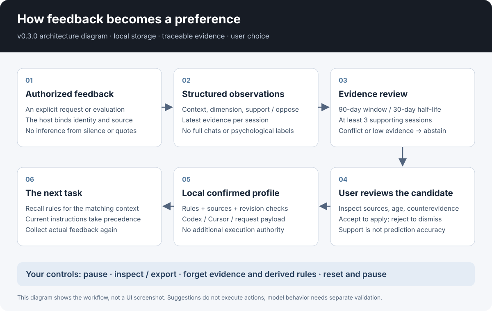
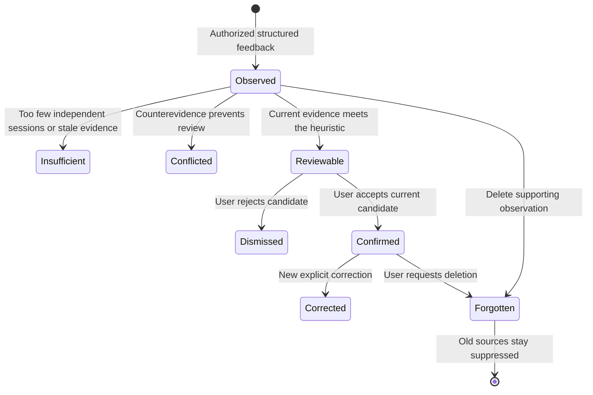
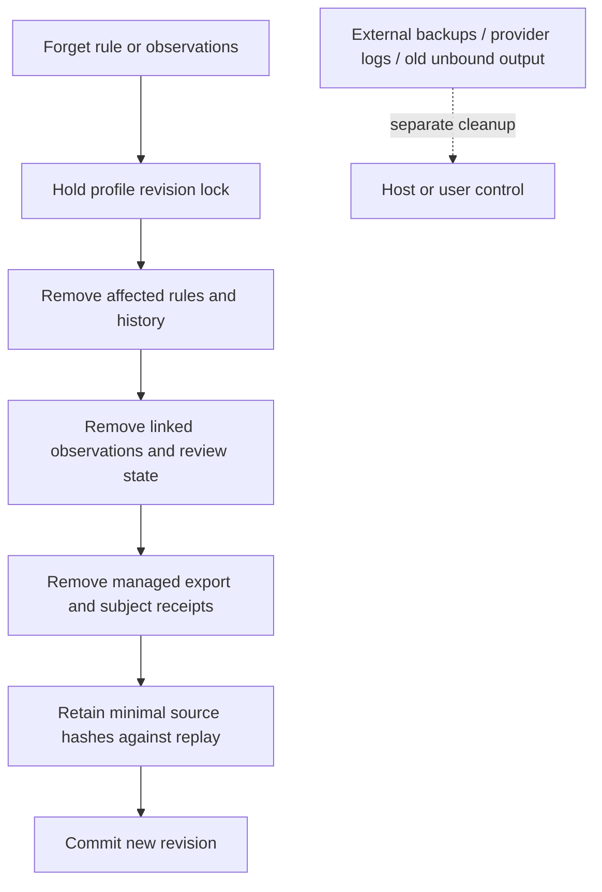

# Structured-feedback architecture — v0.6.0

[English](structured-architecture.en.md) · [中文](structured-architecture.zh-CN.md)

The unit of personalization is an observable collaboration preference: when it applies, what to do, and why it was saved. A profile can say “start code reviews with the main finding.” It cannot establish the user's inner motives or psychological condition.

## Four boundaries

| Layer | Responsibility | Does not provide |
|---|---|---|
| Host | Identity mapping, user permission, source/session IDs, real feedback | Proof from a tool argument that permission exists |
| Adapter | Validate typed input; commit under a revision check; explain candidates | A history crawler or an NLP extractor |
| Private profile | Explicit rules, structured observations, review state, minimal replay markers | A public personality dossier |
| Model invocation | Load confirmed preferences and follow current instructions | Guaranteed compliance or extra tool authority |

The local adapter uses SQLite. `USER_SKILL.md` and the original reflection templates remain portable integration formats; the SQLite path does not automatically maintain a second Markdown profile. Keeping two independently editable sources of truth would create conflicting preferences.

## Observation is not confirmation

A candidate is ready for review only when there are at least three supporting sessions, weighted support is at least 75% of support plus opposition, and at least one supporting event is no more than 30 days old. Events older than 90 days do not contribute. Evidence has a 30-day half-life. Within a context and dimension, a session contributes only its latest observation.

These thresholds are inspectable engineering defaults. They are not trained or calibrated confidence probabilities. Hosts are responsible for assigning honest source and session IDs; the adapter cannot detect fabricated real-world sessions.

A candidate fingerprint binds its context, proposed value, and evidence. A review uses the current profile revision, so an older screen cannot silently confirm a changed candidate. Negative feedback and competing values remain visible as counterevidence.

## Scope and precedence

1. Follow current instructions within the host's instruction hierarchy.
2. Load the confirmed preference for the exact context, with specific structured rules ahead of applicable global defaults.
3. Use explicit corrections to replace old defaults.
4. Keep behavioral candidates out of ordinary recall until review.

The adapter can resolve structured `dimension`/`value` rules. It does not semantically understand every arbitrary free-text rule: an older manual statement can still require human review for a conflict. Expiry is checked as a timezone-aware instant, not a string comparison.

## Explain an inference

An insight includes its scope, dimension, proposed value, supporting/opposing session counts, recency-weighted totals, event IDs, latest timestamp, and reasons. Useful explanations name the evidence and the uncertainty:

> Three independent sessions favored conclusion-first code reviews. No current opposing feedback was found. Review this as a default for code reviews?

Avoid “You are an analytical personality” or “We know you will want this.” Neither follows from the evidence. A next-step preference such as `workflow_next_step=test` means “offer testing in this context,” not “run tests without authorization.”

## Deletion and recovery

Reset clears profile content and ends paused. It does not promise physical disk erasure. Exports and deletion share a transaction boundary to avoid rewriting an old managed export after a deletion. A revision conflict leaves the newer profile in place.

## What a pass means

Stored, loaded, applied, and helpful are different outcomes. Local tests can establish storage and deterministic learning behavior. A host run establishes one actual integration. User benefit needs subsequent feedback; neither a diagram nor a test suite demonstrates it. See [evaluation](evaluation.md).
