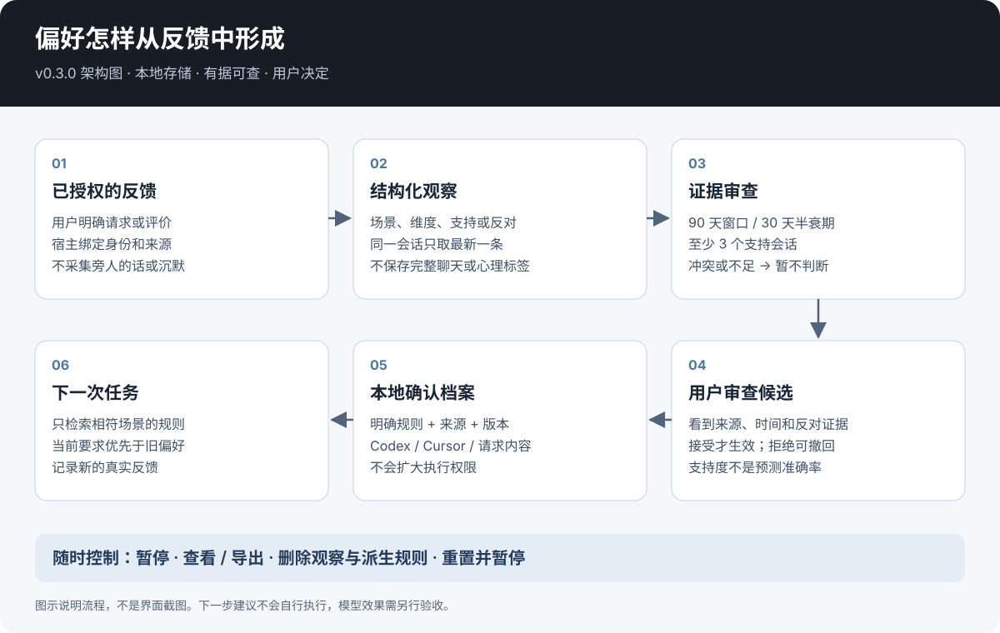
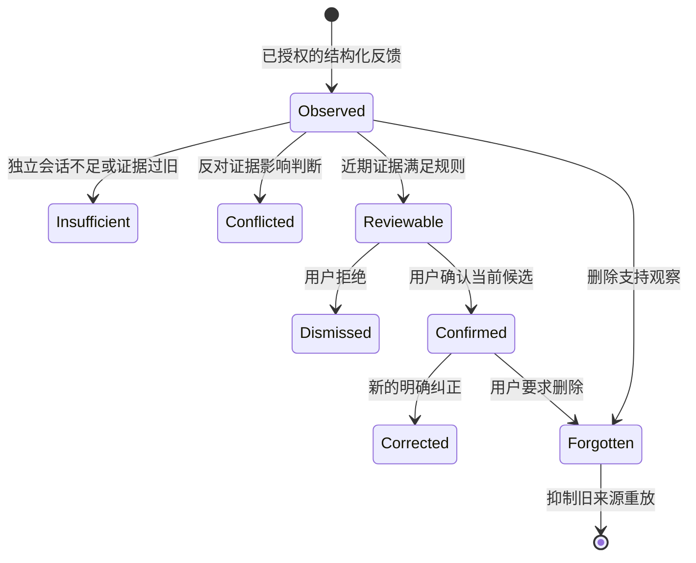
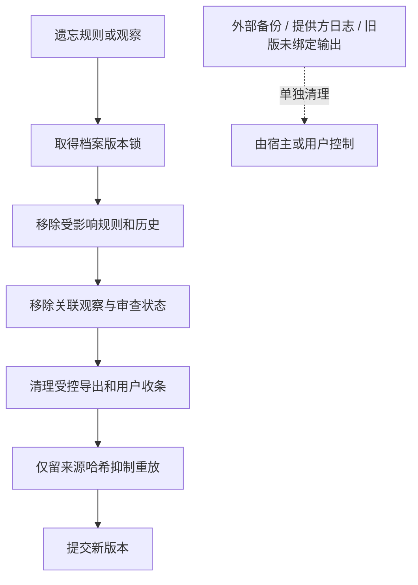

# 结构化反馈架构 — v0.5.1

[English](structured-architecture.en.md) · [中文](structured-architecture.zh-CN.md)

个性化的基本单元是可以观察的协作偏好：什么时候生效、应该怎么做、为什么保存。档案可以记录“代码审查先说主要发现”，不能据此断言用户的内心动机或心理状态。

## 四层职责

| 层次 | 负责什么 | 不代表什么 |
|---|---|---|
| 宿主 | 身份映射、用户授权、来源与会话编号、真实反馈 | 工具参数不能证明授权确实存在 |
| 适配器 | 校验结构化输入、按版本提交、解释候选 | 不提供历史爬虫或自然语言抽取器 |
| 私有档案 | 明确规则、观察、审查状态、最小防重放标记 | 不是公开的人格档案 |
| 模型调用 | 加载已确认偏好，遵守当前指令 | 不保证完全遵守，也不增加工具权限 |

本地适配器使用 SQLite。原有 `USER_SKILL.md` 与反思模板仍可作为其他宿主的便携格式，但 SQLite 路径不会自动维护第二份 Markdown 档案，避免两个独立可编辑的来源相互冲突。

## 观察不等于确认

候选需要同时满足：至少三个支持会话；加权支持占支持与反对总量的 75% 以上；至少一条支持证据在近 30 天内。超过 90 天的事件不参与计算，时间权重半衰期为 30 天。同一场景、同一维度中，一个会话只贡献最新一条观察。

这些阈值是可查看的工程默认值，不是训练或校准得到的置信概率。宿主必须提供真实来源和会话编号；适配器无法识别现实中被伪造的会话。

候选指纹绑定场景、建议值和证据。确认还需要当前档案版本，避免旧页面悄悄确认已经变化的候选。反对反馈和竞争值会作为反向证据呈现。

## 场景与优先级

1. 在宿主指令层级内遵守当前要求。
2. 加载完整场景对应的已确认偏好；具体结构化规则优先于适用的全局默认值。
3. 用明确纠正替换旧默认。
4. 行为候选未经确认，不进入普通检索。

适配器可以处理结构化的 `dimension` / `value` 规则，但不会理解任意自由文本的所有语义；旧手写规则之间的冲突仍可能需要人工判断。到期时间按带时区的真实时刻判断，不直接比较字符串。

## 怎样解释一次推断

每条候选提供场景、维度、建议值、支持和反对会话数、时间加权总量、事件 ID、最近时间与理由。合适的解释应该说清依据与不确定性：

> 三个独立会话都更认可结论先行的代码审查，目前没有近期反对反馈。是否把它设为代码审查的默认格式？

不要写“你属于分析型人格”或“我们知道你接下来想做什么”，这些结论不在证据范围内。`workflow_next_step=test` 表示在相应场景中建议测试，不代表可以未经授权执行测试。

## 删除与恢复

重置会清空内容并保持暂停，不承诺物理擦盘。导出与删除使用一致的事务边界，避免删除后又写回旧导出；版本冲突时保留更新的档案。

## 通过测试意味着什么

保存、加载、实际采用和对用户有帮助，是不同结果。本地测试能验证存储与确定性的学习行为；一次宿主调用只能证明该次实际接入。用户收益仍需后续真实反馈，图解和测试套件都不能替代。参见[验收](evaluation.zh-CN.md)。
