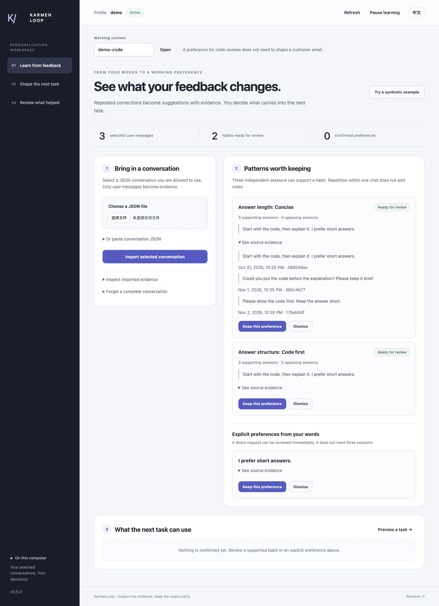
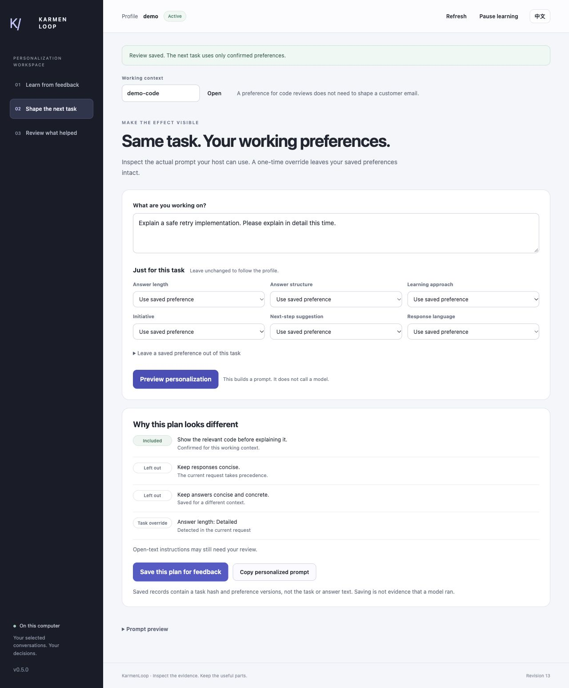

# Use the personalization workspace — v0.6.0

[English](tutorial.en.md) · [中文](tutorial.zh-CN.md)

The first useful result is visible: a repeated correction becomes a reviewed preference, and you can see exactly when the next task uses—or overrides—it. This walkthrough needs no model account.

## 1. Download and start

Download the ZIP and `SHA256SUMS.txt` from [v0.5.1](https://github.com/KarmenLoop/user-behavior-personalization/releases/tag/v0.6.0). Check the ZIP's SHA-256 before extraction: `shasum -a 256` on macOS, `sha256sum` on Linux, or `Get-FileHash -Algorithm SHA256` in PowerShell.

Use Python 3.11+ from the extracted directory:

```sh
python3 --version
python3 -B scripts/check_package.py
python3 -B scripts/workspace.py --root ../private-profile --subject demo --enable-conversations
```

Windows may use `py -3.12` instead of `python3`. Open the local URL printed by the last command. The process stays in the foreground; press Ctrl+C in its terminal to stop it. Closing the browser tab does not stop the server. The private root belongs outside the package and Git.

To install a portable copy, run `python3 scripts/install_skill.py --destination ../installed-skills/user-behavior-personalization` with a destination that does not exist. The package has no third-party Python runtime dependencies.

## 2. Learn from three corrections

In **Learn from feedback**, choose **Try a synthetic example**. This imports three separate synthetic conversations in `demo-writing`, each containing “Too long. Please keep it brief.” No real chat history is accessed.

Under **Patterns worth keeping**, inspect the candidate's source evidence and supporting sessions. Select **Keep this preference**. It now appears under **What the next task can use**. Repeating the same source or importing the same demonstration again does not manufacture extra votes.

A real import works the same way: select a conversation JSON file, or paste it, then choose **Import selected conversation**. Only authorized user messages become evidence. A direct statement such as “From now on, include rollback checks” appears as an explicit proposal; recurring correction cues use the separate multi-session habit review.



*This is a real local workspace capture. Any prompt comparison is not a generated model answer.*

## 3. See what changes for a task

Open **Shape the next task**. Keep the working context set to `demo-writing`, enter “Explain the tradeoffs in a release plan,” and select **Preview personalization**.

**Why this plan looks different** explains inclusion or exclusion. Expand **Prompt preview** to compare the prompt without saved preferences with the one that includes selected confirmed preferences. Both include the same fixed evidence-first guidance. On a narrow screen, the two panels stack. This is the same resolver used by the context builder and host wrapper.

Under **Just for this task**, choose a detailed response length and preview again. The saved brevity preference is excluded with the current-task-override reason. The profile still keeps its concise default. You can also leave a specific saved rule out of this task without deleting it.

The resolver recognizes a small set of explicit instructions in task text, such as “keep it brief” or “explain in detail.” The controls let you correct those choices. It does not reliably interpret every indirect instruction or semantic conflict between free-text rules.



*This separate synthetic code task keeps a code-first rule and overrides the brevity rule. The task-text instruction is visible, along with the selection reasons. Expand Prompt preview to inspect the composed text.*

## 4. Record what helped

Choose **Save this plan for feedback**, then open **Review what helped**. Select the plan and the basis of your assessment:

- **I reviewed the prompt only** when you have inspected the preview.
- **I used the resulting response** only after you actually used a response through a host.

Choose **Helpful**, **Mixed**, **Not helpful**, or **Not sure**. The record is an explicit user assessment, not an automatically measured quality score. The local workspace does not call a model when you preview, save, or rate a plan.

Saved plan records contain a task hash, revision, and exact preference-version fingerprints—not raw task or response text. Correct a preference and its new version starts without inherited ratings. Deleting a plan removes its associated feedback.

## 5. Correct or remove a habit

Return to the confirmed preference and choose **Correct**. Change the statement or supported setting, then save. The next preview uses the new version. For a one-time exception, use task controls instead of permanently correcting the profile.

**Forget** removes the selected content and dependent records. Removing a supporting message or conversation can remove learned preferences, prepared plans, and feedback linked to them. Inspect the source before deleting it. **Pause learning** stops ordinary personalization; inspection/export and deletion controls remain available through the local tools.

A shared computer still needs appropriate OS accounts and file permissions. The browser interface cannot switch the server's bound subject or private root.

## 6. Follow a selected conversation feed

A host or your own exporter can append full conversation snapshots to one JSONL file:

```sh
python3 -B scripts/watch_conversations.py --root ../private-profile --subject owner \
  --enable-conversations --input /path/to/selected.jsonl
```

Each line is a whole conversation object, not a message object. Leave the watcher running in a terminal, or add `--once` for one bounded import. It processes complete new lines, preserves a restart cursor, and reports errors rather than skipping a rejected record. See [automatic learning](automatic-learning.en.md) for an executable feed example and recovery rules.

Use the same subject and root in the workspace to inspect that feed's imported evidence. Refresh the workspace after new data arrives. No account crawler or background service is installed.

## 7. Connect Codex, Cursor, or a model client

```sh
python3 scripts/host.py --root ../private-profile --subject owner \
  --workspace /path/to/project --enable-conversations --install-host codex install
```

Use `--install-host cursor` for Cursor. Reload and approve the specific MCP server, then verify its [25 tools](tools.en.md). Configuration alone does not establish a successful model answer.

To build actual scoped messages without sending them:

```sh
python3 scripts/build_context.py --root ../private-profile --subject owner \
  --context writing --task-file /path/to/private-task.txt \
  --override response_length=detailed
```

The override applies only to this request. `--omit-rule RULE_ID` excludes a saved rule; `--preference-budget 4000` bounds included preference text. Your client can use the returned `messages` value according to its provider API, including DeepSeek-style APIs. The builder itself performs no network call.

For a new Codex/ Cursor CLI invocation, use `scripts/run_host.py` with `--root`, `--subject`, `--context`, `--host`, `--workspace`, and `--prompt`; it shares the same override options. Codex receives the prompt on stdin. The current Cursor CLI passes it as a positional argument, visible to same-user process inspection. Host accounts, permissions, logs, and provider retention remain separate.

## 8. Go beyond the demonstration

Import actual authorized feedback across different tasks. Check that one-session repetition, quotes, temporary requests, and conflicting feedback do not become an unwanted lasting habit. Try a temporary override, a permanent correction, and a source deletion. Ask the user whether an actual response improved.

Use [evaluation](evaluation.md) to separate unit tests, the browser walkthrough, blind habit diagnostics, and real model responses. The first independent habit diagnostic missed every positive case; that failure remains in the record. Final reported quality should come from the separate frozen evaluations, not this easy demonstration.

Open-text conversation import, project terminology, goals, portraits, and experimental historical forecasts remain in the [conversation guide](conversation-guide.en.md). The [structured-feedback guide](structured-feedback.en.md) covers direct typed observations. Those paths are complementary, not duplicate profiles.
