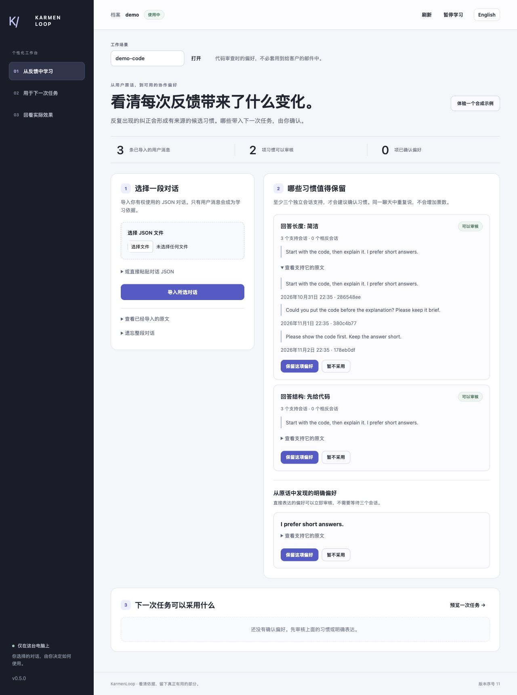
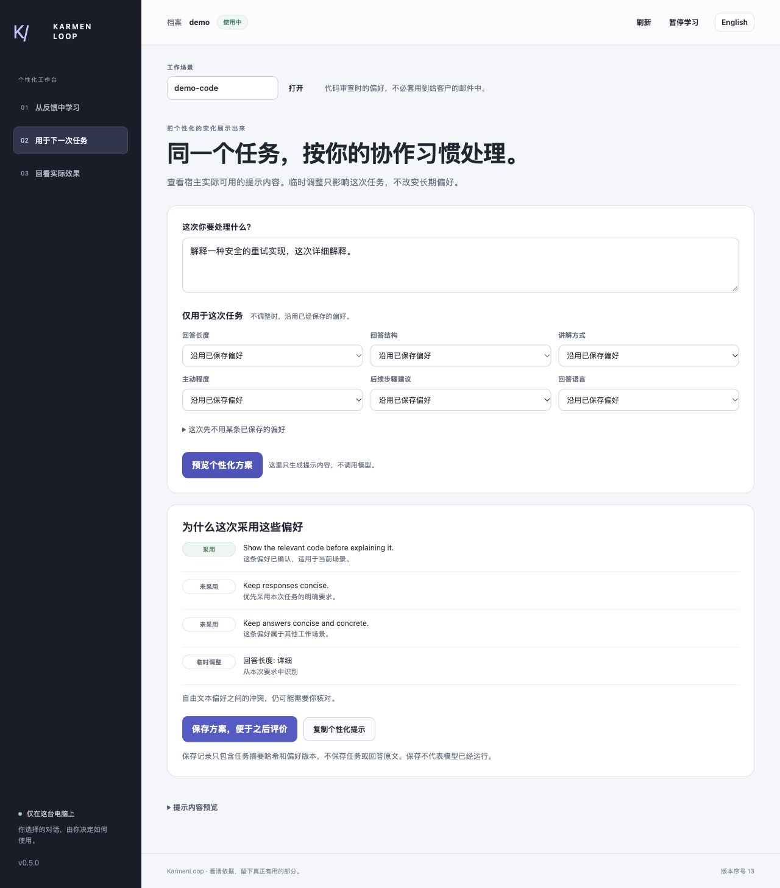

# 使用个性化工作台 — v0.5.1

[English](tutorial.en.md) · [中文](tutorial.zh-CN.md)

先看到一个有用的结果：反复纠正形成经确认的偏好，下一次任务什么时候采用、什么时候临时覆盖，都能看清。本教程无需模型账号。

## 1. 下载并启动

从 [v0.5.1](https://github.com/KarmenLoop/user-behavior-personalization/releases/tag/v0.5.1) 下载 ZIP 和 `SHA256SUMS.txt`，解压前核对 SHA-256。macOS 使用 `shasum -a 256`，Linux 使用 `sha256sum`，PowerShell 使用 `Get-FileHash -Algorithm SHA256`。

在解压目录使用 Python 3.11+：

```sh
python3 --version
python3 -B scripts/check_package.py
python3 -B scripts/workspace.py --root ../private-profile --subject demo --enable-conversations
```

Windows 可按安装情况使用 `py -3.12`。打开最后一条命令打印的本地地址。进程在前台运行，停止时在终端按 Ctrl+C；只关浏览器标签不会停止服务。私有数据目录应在包和 Git 之外。

需要便携副本时，运行 `python3 scripts/install_skill.py --destination ../installed-skills/user-behavior-personalization`，目标目录必须尚不存在。没有第三方 Python 运行依赖。

## 2. 从三次纠正中学习

在**从反馈中学习**页面，点击**体验一个合成示例**。它在 `demo-writing` 中导入三个独立合成会话，每个含“太长了，请简短一点”，不读取真实聊天历史。

在**哪些习惯值得保留**中查看原文与支持会话，选择**保留这项偏好**，随后它会出现在**下一次任务可以采用什么**里。同一来源重复导入，或重复点击示例，不会制造更多票数。

真实导入方式相同：选择 JSON 对话文件或粘贴内容，再点**导入所选对话**。只有获授权的本人消息成为依据。“以后发布方案都加回滚检查”等直接要求，会列为明确偏好提案；反复纠正则走独立的多会话习惯审查。



*v0.5.0 本地工作台的历史截图；v0.5.1 新增判断规则面板。提示对比不是模型生成的回答。*

## 3. 看清一次任务发生了什么变化

进入**用于下一次任务**，保持 `demo-writing` 场景，输入“解释这份发布方案中的取舍”，点击**预览个性化方案**。

**为什么这次采用这些偏好**解释采用或排除的原因。展开**提示预览**，可以对比不采用已保存偏好和加入选定偏好后的提示。两侧都包含相同的固定判断规则。窄屏时两块内容上下排列。上下文生成器和宿主包装入口也使用相同选择逻辑。

在**仅用于这次任务**中选择详细回答，再预览。已存的简洁偏好会因本次要求被排除，长期档案仍保留简洁默认值。也可以让某条已保存规则本次不参与，而不删除它。

任务文本中的少量明确表达，例如“简短一点”“详细解释”，能被识别为临时要求；界面控件可纠正选择。它不能可靠理解所有间接表达，也不会自动解决自由文本规则之间的全部语义矛盾。



*这张 v0.5.0 截图使用另一项合成代码任务：保留先给代码的规则，临时覆盖简短偏好。页面展示任务中的明确要求及选择原因，展开「提示预览」可检查组合后的原文。*

## 4. 记录什么真的有帮助

点击**保存方案，便于之后评价**，进入**回看实际效果**，选择方案和评价对象：

- 只看过预览时，选择**我只看过提示方案**。
- 通过宿主真正使用了生成回答后，才选择**我实际使用了生成的回答**。

再选择**有帮助**、**有好有坏**、**没有帮助**或**还不确定**。这是真实用户评价，不是系统自动算出的质量分。预览、保存、评价都不会在本地工作台触发模型调用。

方案记录只保存任务哈希、版本和确切偏好版本指纹，不保存任务或回答原文。偏好被纠正后，新版本不会继承旧评分。删除方案会移除它的关联反馈。

## 5. 纠正或删除习惯

回到已确认偏好，点击**纠正**，修改陈述或受支持的设置并保存；下一次预览使用新版本。只是本次例外时，应使用任务控制，不必永久更正档案。

**遗忘**会清理指定内容及依赖记录。删除支持消息或会话，可能连带删除学习出的偏好、关联方案与反馈，操作前先查看来源。**暂停学习**停止普通个性化；本地工具仍支持查看/导出及删除。

共享电脑仍需合适的系统账号和文件权限。浏览器不能切换服务绑定的 subject 或私有目录。

## 6. 持续处理选定对话文件

宿主或自己的导出程序，可以向一个 JSONL 文件追加完整会话快照：

```sh
python3 -B scripts/watch_conversations.py --root ../private-profile --subject owner \
  --enable-conversations --input /path/to/selected.jsonl
```

每行是完整会话对象，不是消息对象。监听器在终端前台运行；加 `--once` 可执行一次有限导入。它只处理完整新行，保留重启位置，遇到拒绝记录会报错，不会静默跳过。[自动学习指南](automatic-learning.zh-CN.md)提供可运行示例和恢复说明。

工作台使用相同 subject 与根目录即可查看该文件产生的证据，新数据到来后刷新。不会安装账号爬虫或后台服务。

## 7. 接入 Codex、Cursor 或模型客户端

```sh
python3 scripts/host.py --root ../private-profile --subject owner \
  --workspace /path/to/project --enable-conversations --install-host codex install
```

Cursor 使用 `--install-host cursor`。重新加载并批准指定 MCP 服务，核对 [25 个工具](tools.zh-CN.md)。配置成功不等于模型回答成功。

生成实际限定上下文而不发送：

```sh
python3 scripts/build_context.py --root ../private-profile --subject owner \
  --context writing --task-file /path/to/private-task.txt \
  --override response_length=detailed
```

覆盖仅作用于本次请求。`--omit-rule RULE_ID` 排除一条已存规则，`--preference-budget 4000` 限制纳入的偏好文字量。自己的客户端可按提供方 API 使用返回的 `messages`，包括 DeepSeek 类接口；生成器不执行网络调用。

新 Codex/Cursor CLI 调用使用 `scripts/run_host.py`，传 `--root`、`--subject`、`--context`、`--host`、`--workspace`、`--prompt`，并支持相同覆盖参数。Codex 用 stdin 接收提示；当前 Cursor CLI 使用位置参数，同用户进程查看可能看到内容。宿主账号、权限、日志及提供方留存需另行处理。

## 8. 超出演示继续验收

导入跨任务的真实授权反馈，检查单会话重复、引用、临时要求和相反反馈不会形成不合适的长期习惯。尝试一次临时覆盖、一次永久纠正、一次来源删除，再询问本人实际回复是否改善。

[验收指南](evaluation.zh-CN.md)区分单元测试、浏览器流程、盲测习惯诊断与真实模型回答。第一次独立习惯诊断漏掉了全部正例，失败记录保留；最终质量应看独立冻结评估，而不是这个容易通过的演示。

自由文本提取、项目术语、目标、表达档案和实验性历史预测仍见[对话指南](conversation-guide.zh-CN.md)；直接传入类型化观察见[结构化反馈指南](structured-feedback.zh-CN.md)。这些是互补入口，不是多份重复档案。
